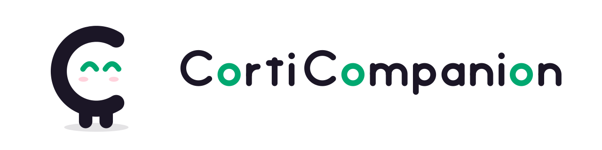
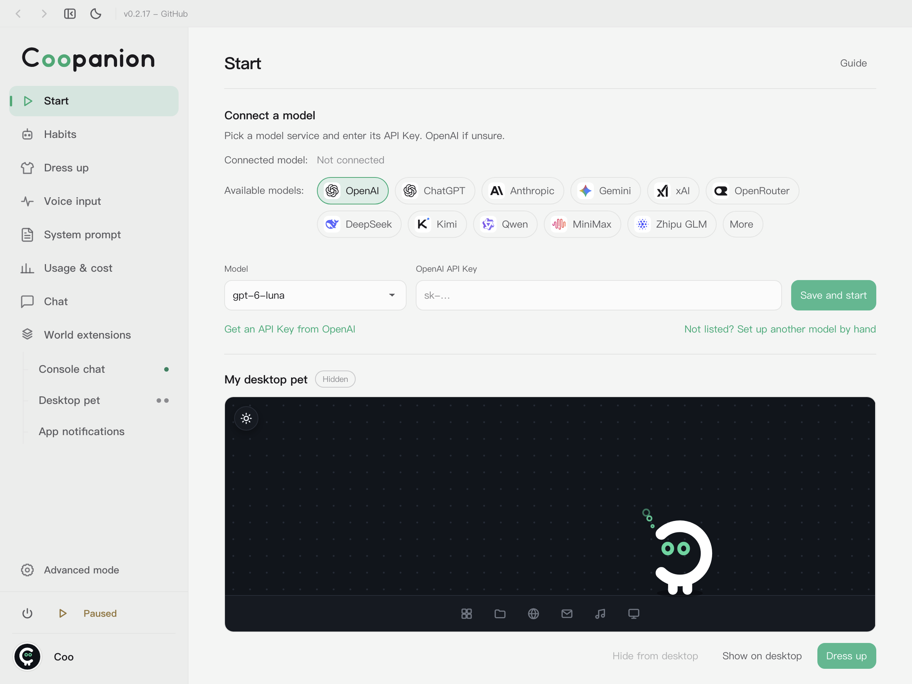
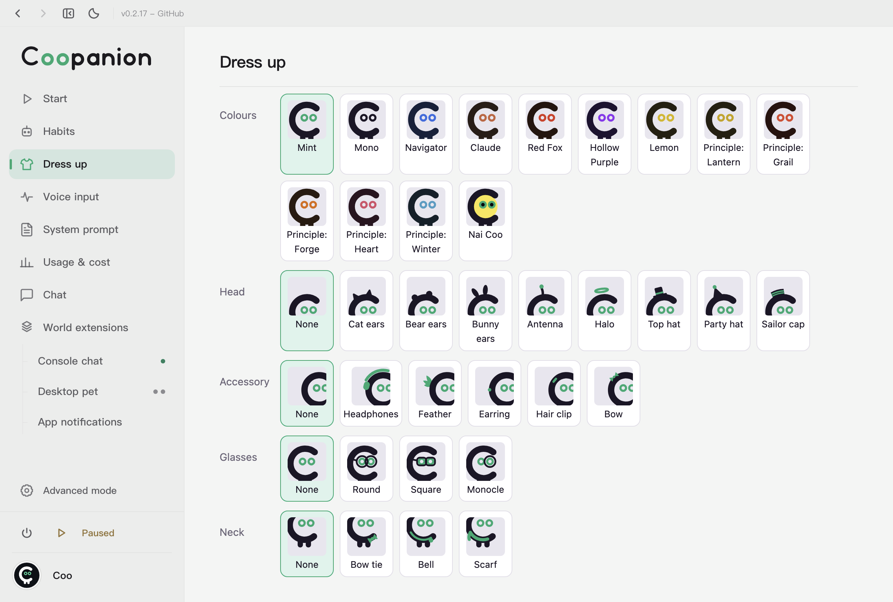
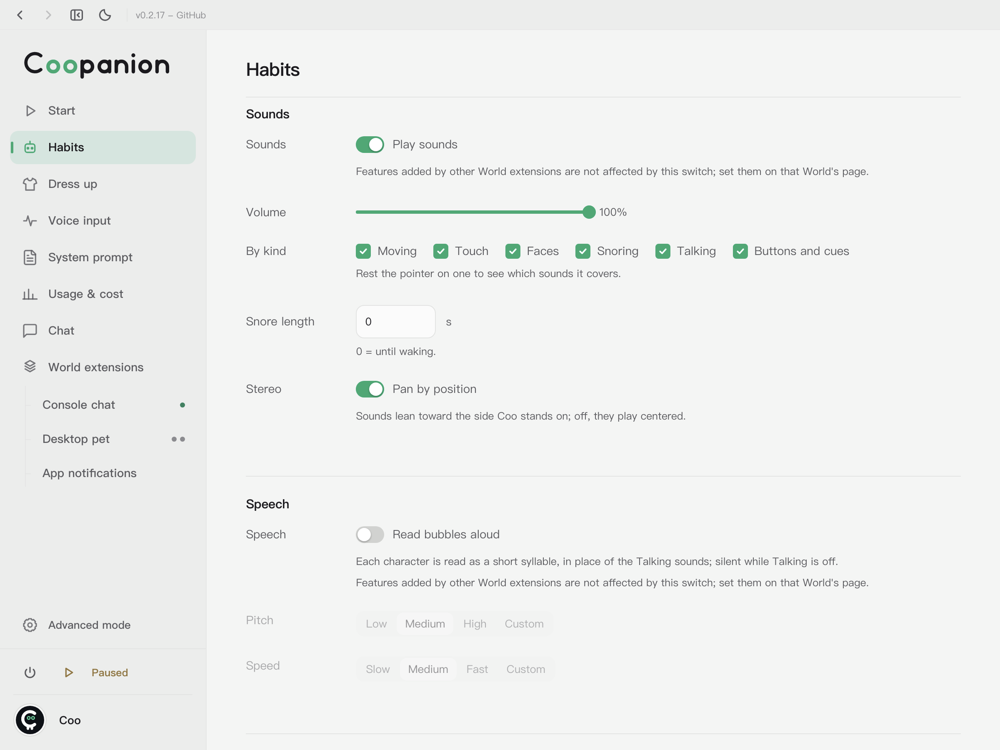
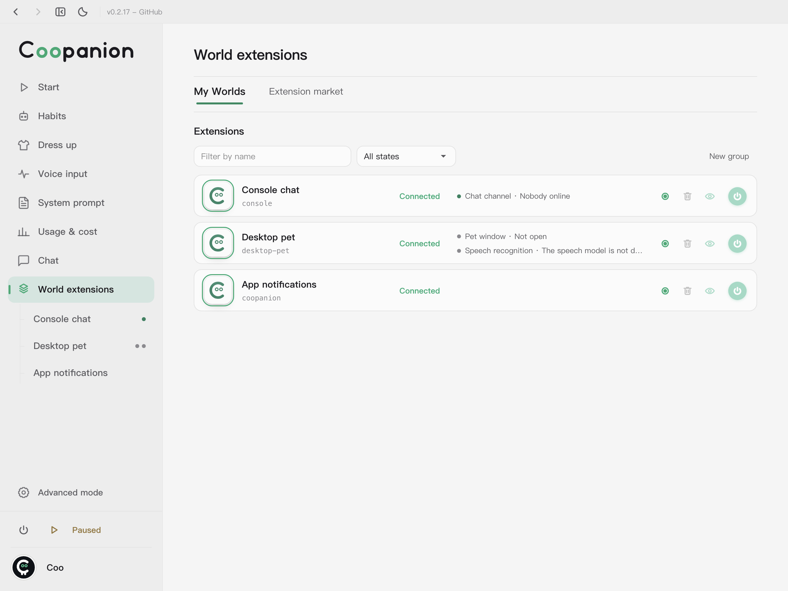

<!-- Owner: app/main.cjs, core/companion.ts, console/index.ts. -->
<p align="center">
  <picture>
    <source media="(prefers-color-scheme: dark)" srcset="assets/banner-dark.svg">
    
  </picture>
</p>

<p align="center">
  English ｜
  <a href="README_zh.md">简体中文</a>
</p>

<p align="center">
  <a href="https://github.com/Pal-AI-Lab/Coopanion/releases/latest"></a>
  <a href="https://github.com/Pal-AI-Lab/Coopanion/actions/workflows/ci.yml"></a>
  
  
  
  <a href="LICENSE"></a>
</p>

<p align="center">
  <a href="https://coo.palailab.org">Website</a> ｜
  <a href="#install">Install</a> ｜
  <a href="#getting-started">Getting Started</a> ｜
  <a href="#everyday-use">Everyday Use</a> ｜
  <a href="#cost-and-privacy">Cost and Privacy</a> ｜
  <a href="#faq">FAQ</a> ｜
  <a href="#community">Community</a> ｜
  <a href="https://github.com/Pal-AI-Lab/Coopanion/releases">Changelog</a> ｜
  <a href="docs/DEVELOPMENT.md">Development</a>
</p>

Coopanion is a desktop pet named Coo that lives on the bottom edge of your screen. It wanders along the edge, chats with you in speech bubbles and listens while you hold the talk key. If you let it, it can also look at your screen, click and type to use the computer for you. It runs on Windows, macOS and Linux.

The interface comes in 11 languages: 简体中文, 繁體中文, English, 日本語, 한국어, Français, Deutsch, Español (Latinoamérica), Português (Brasil), Italiano and Русский. On first start it follows the system language, falling back to English, and you can change it later under **Language** on the Habits page. Coo talks to you in the same language. Translations other than Simplified Chinese and English are machine-made; PRs that fix them are welcome.

<p align="center"></p>

## Features

- Works with OpenAI, Anthropic, Gemini, xAI, OpenRouter, DeepSeek, Kimi, Qwen, MiniMax, Zhipu GLM, Doubao, Baidu Qianfan and StepFun: pick one and paste an API key. You can also sign in with a ChatGPT account and use its ChatGPT plan.
- Hold the talk key and speak, or type. Coo answers in a bubble. Speech is recognized on your machine by default, or by a transcription service you set up.
- Coo remembers you. What it knows about you is written to `PARTNER.md`, and longer memories are organized by topic and date. When Git is available, every change Coo makes to its text keeps a history; Windows ships with Git, macOS and Linux use the one installed on the system.
- With your permission, Coo can look at the screen, click, type and switch windows. This is off by default and you decide when it asks first. It pauses as soon as you touch the mouse or keyboard, and talking with the talk key interrupts it.
- An icon over Coo's head shows when it is thinking, reading files, searching, writing or using the computer.
- Pick Coo or **DeepSeek Chan**, an animated whale girl with eight vendor color schemes and three outfits. Other figure packs are imported on the Dress up page; see the [figure pack compatibility promise](packages/cortico-world-desktop-pet/README.md#形象包兼容承诺).
- Coo comes in several colors, including Nai Coo and five Cultist Simulator principles, and can wear a hat, animal ears or a halo, headphones, an earring or a bow, glasses and neckwear. The size of the pet, its bubbles and the text can each be adjusted.
- Ask Coo to remind you at a time of day or in a few minutes, and it sets an alarm.
- Install Worlds such as a QQ bot, a drawing room and small games from **World extensions → Extension market**.
- Export Coo and its bubbles as an OBS Browser source with a transparent background, to put it on a stream.

What changed in each version is in [Releases](https://github.com/Pal-AI-Lab/Coopanion/releases).

## Install

You need:

- Windows 10 / 11 (64-bit), macOS 13 or later (Apple silicon or Intel), or a 64-bit Linux desktop (X11, or XWayland under Wayland; speech recognition needs glibc 2.32 or later, which means Ubuntu 22.04, Debian 12 or newer);
- an API key from one model service, billed by usage (see [Cost and privacy](#cost-and-privacy)), or a ChatGPT account with a plan.

Every release page has a `SHA256SUMS.txt` for checking the downloads.

### Windows

- **Installer**: download `Coopanion-Setup-<version>.exe` from the [latest release](https://github.com/Pal-AI-Lab/Coopanion/releases/latest) and run it. The installer is not code-signed, so Windows may say "Windows protected your PC": click **More info** → **Run anyway**. It installs to `%LOCALAPPDATA%\Programs\Coopanion` by default, and the program and its data both live in that folder. Don't install it into Program Files or another folder that needs administrator rights: Coopanion can't write its data there and quits with an error. There is no Start menu entry; open it from the desktop icon.
- **One command**: in PowerShell, run

  ```powershell
  irm https://raw.githubusercontent.com/Pal-AI-Lab/Coopanion/main/installer/install.ps1 | iex
  ```

  If antivirus software blocks the graphical installer, the script keeps the downloaded installer and prints its path. Run it silently with `Coopanion-Setup-<version>.exe /S`, or add Coopanion to your antivirus's allowed list and try again.
- **Portable**: download `Coopanion-<version>-win-x64-portable.zip` from the [latest release](https://github.com/Pal-AI-Lab/Coopanion/releases/latest), unpack it anywhere and run `Coopanion.exe`. Its data is kept in the folder's `data`. Copy the whole folder and you have a second Coo with its own memory and settings; up to 5 can run at once, installed and portable together. The portable version does not update itself: unpack the new version into a new folder and copy the old `data` over.

### macOS

1. From the [latest release](https://github.com/Pal-AI-Lab/Coopanion/releases/latest), download `Coopanion-<version>-mac-arm64.dmg` (Apple silicon) or `…-mac-x64.dmg` (Intel), open it and drag Coopanion into Applications.
2. The app is neither signed with an Apple developer ID nor notarized, so macOS blocks the first launch. Open it once and click **Done** on the warning, then go to System Settings → Privacy & Security, click **Open Anyway** and enter your password.
3. Coopanion's icon is in the menu bar. It shows up in the Dock only while the settings window is open.

While the App Store is in front, Coo drops behind other windows so it doesn't cover the Touch ID prompt for purchases.

> [!NOTE]
> macOS asks for Microphone (voice input), Input Monitoring (talk key), Screen & System Audio Recording and Accessibility (computer use) the first time each one is needed, and switching apps during computer use also asks to control "System Events". Restart Coopanion after changing Screen Recording, Input Monitoring or Accessibility. macOS does not carry these permissions over to an updated version: if a switch is on but Coopanion says the permission is missing, remove Coopanion from that list with −, add `/Applications/Coopanion.app` back and restart.

### Linux

1. From the [latest release](https://github.com/Pal-AI-Lab/Coopanion/releases/latest), download `Coopanion-<version>-linux-x64.deb` (Debian / Ubuntu) or `Coopanion-<version>-linux-x64.AppImage` (other distributions).
2. deb: `sudo apt install ./Coopanion-<version>-linux-x64.deb`. AppImage: install your distribution's FUSE 2 compatibility library, run `chmod +x Coopanion-*.AppImage`, then start it.

> [!NOTE]
> The pet is a transparent always-on-top window, so the desktop needs compositing (on by default in GNOME and KDE). The tray icon needs status icon support (GNOME needs the AppIndicator extension); without a tray you can still right-click Coo to open the settings. Computer use needs `xdotool` and `zenity`, which the deb pulls in; under Wayland, screenshots also need one of `grim`, `spectacle`, `scrot` or ImageMagick.

## Getting started

1. **Start**: Coo drops to the bottom of the screen and an icon appears in the tray (the menu bar on Mac, the status bar on Linux). No window opens.
2. **Follow the guide**: in its bubbles, Coo asks for the interface language, where you heard about it (you can skip this), what it should call you, what Coo is like, how often it walks around, which touches it should answer and which model service to use. Then it downloads the speech model: FunASR, about 230 MB, or Whisper, about 360 MB, when the interface language is French, German, Spanish, Portuguese, Italian or Russian. The download comes from ModelScope and falls back to Hugging Face. **Back** at the top left of the bubble returns to the step before, with your earlier answer in place. The × ends the guide, and **Guide** on the Start page runs it again. To change Coo's personality or the way it talks afterwards, just tell it; it writes the persona into its prompt itself.
3. **Say hello**: tap **Left Alt** (**Left Option** on Mac), then press and hold it, say "hello", and let go to send. Allow microphone access when asked.

<details>
<summary><b>Connect a model: API key or ChatGPT sign-in</b></summary>

Choose a service in Coo's bubble or on the Start page, create an API key on its platform (DeepSeek also needs a topped-up balance) and paste it in.

| Service | Get a key | Default model |
| --- | --- | --- |
| OpenAI | [platform.openai.com](https://platform.openai.com/settings/organization/api-keys) | `gpt-6-luna` |
| Anthropic | [platform.claude.com](https://platform.claude.com/settings/keys) | `claude-haiku-5-5` |
| Gemini (Google AI Studio) | [aistudio.google.com](https://aistudio.google.com/apikey) | `gemini-3.5-flash-lite` |
| xAI | [console.x.ai](https://console.x.ai/team/default/api-keys) | `grok-4.3` |
| OpenRouter | [openrouter.ai](https://openrouter.ai/settings/keys) | `deepseek/deepseek-v4.1-flash` |
| DeepSeek | [platform.deepseek.com](https://platform.deepseek.com/api_keys) | `deepseek-flash` |
| Kimi (Moonshot) | international [platform.kimi.ai](https://platform.kimi.ai/console/api-keys), mainland China [platform.kimi.com](https://platform.kimi.com/console/api-keys) | `kimi-k3` |
| Qwen (Alibaba Cloud Model Studio) | international [modelstudio.console.alibabacloud.com](https://modelstudio.console.alibabacloud.com/ap-southeast-1/model/settings/api-key), mainland China [bailian.console.aliyun.com](https://bailian.console.aliyun.com/cn-beijing/model/settings/api-key) | `qwen3.8-flash` |
| MiniMax | international [platform.minimax.io](https://platform.minimax.io/user-center/basic-information/interface-key), mainland China [platform.minimax.cn](https://platform.minimax.cn/user-center/basic-information/interface-key) | `MiniMax-M3` |
| Zhipu GLM | international (Z.ai) [z.ai](https://z.ai/manage-apikey/apikey-list), mainland China [bigmodel.cn](https://bigmodel.cn/usercenter/proj-mgmt/apikeys) | `glm-5.3-flash` (if it fails to connect on the mainland China platform, `glm-5.3` works, but it can't see images, so no computer use) |
| Doubao (Volcengine Ark) | [ark.volcengine.com](https://ark.volcengine.com/region:cn-beijing/apikey) | `doubao-seed-2-1-lite-260915` (enable it in the Ark console first) |
| Baidu Qianfan | [console.bce.baidu.com](https://console.bce.baidu.com/iam/#/iam/apikey/list) | `glm-5.3-flash` |
| StepFun | [platform.stepfun.com](https://platform.stepfun.com/interface-key) | `step-3.7-flash` |
| StepFun Step Plan | [platform.stepfun.com](https://platform.stepfun.com/interface-key) | `step-5-preview` (billed to the Step Plan subscription) |

These are the defaults from the app's [vendor table](packages/cortico-provider-coo/src/vendors.ts). To use another model, change the Model field on the Start page; for computer use the model has to accept images. Kimi, Qwen, MiniMax and Zhipu GLM each have a mainland China and an international platform with separate accounts and keys. A new connection uses the mainland platform when the interface language is Simplified Chinese and the international one otherwise; switch on the Start page. Doubao, Baidu Qianfan, StepFun and StepFun Step Plan only take mainland China accounts. We have only tested DeepSeek, Anthropic and StepFun Step Plan with real keys, so please open an issue if another one fails.

**ChatGPT** needs no key: choose it, press **Continue with ChatGPT** and sign in in the browser that opens. Coo then uses that account's ChatGPT plan. When the plan's usage limit is reached, Coo goes quiet and tries again every 5 minutes.

</details>

## Everyday use

### Talking and playing

- **Talk**: tap **Left Alt** (**Left Option** on Mac), then hold it and speak; let go to send. The talk key, microphone, speech threshold and listening mode (**While the talk key is held**, **The talk key switches it on and off**, **All the time**) are on the Voice input page. With the system default microphone selected, Coo switches along when you change the system's default input device. If the chosen microphone is unplugged or can't be found, Coo listens through the system default input and switches back when it returns. Voice input uses echo cancellation and noise suppression but not automatic gain control, so Coo leaves the system's microphone volume alone; if your voice comes through too quiet, raise the input volume in the system settings.
- **Type**: hover over Coo and click the bubble button next to it, or type on the Chat page. Turn on **Habits → Typing key** to open the typing box from any window (double-press Left Ctrl by default). A message can carry up to four pasted images from the typing box, or eight from the Chat page.
- **Changing keys**: the talk key and the typing key can each be another key, a key combination or a mouse side button, pressed one to three times. When both use the same key, a quick double tap opens the typing box; holding the last press for more than 300 ms starts listening instead and does not open the box. What you say during those 300 ms is kept; with **Open the microphone only while held** on, the microphone opens only at that point, so wait for the listening bubble before speaking.
- **Bubbles**: a bubble stays open while the mouse is over it. Activity bubbles, input bubbles, bubble and text size, and how fast the text appears are on the Habits page.
- **Alarms**: the alarms Coo has set are listed under **Alarms** on the App notifications page, where you can delete them; Coo is told when you do. Daily alarms keep ringing at the same local time across daylight-saving changes. Alarms missed while the app was closed go off the next time it starts.
- **Touch**: click to poke Coo, rub back and forth over its head to pat it, or drag to pick it up. Let go mid-swing to throw it; drop it on another display and it stays there. **Habits → Response mode** decides which touches Coo answers right away.

Speech is recognized locally by default: FunASR for Chinese, English, Japanese and Korean, Whisper for French, German, Spanish, Portuguese, Italian and Russian, and on Windows you can also use the system recognizer. You can switch to an **OpenAI-compatible** transcription service on the Voice input page instead; each sentence you say is then sent to that service as audio.

Right-click Coo to open settings, the typing box or dress up, to switch voice input, sounds and night mode on or off, and to pause / resume, hide or quit. Hovering the dress button shows your favourite looks in a row over Coo's head; scroll or click to switch. Closing the settings window does not quit the app. The tray menu (the menu bar icon on Mac) also has **Start at login**, **Restart** and **Let clicks pass through Coo**. With click-through on, every click goes through Coo to the window below while Coo keeps walking and talking, which helps while gaming. It only lasts for the current run: click it again or quit to turn it off.

### Appearance and sound

Change the figure, colors and accessories on the **Dress up** page, including the accessories' main and accent colors; changes apply right away. Figure packs can be imported from a zip or a folder, or dragged onto the page, and imported packs are uninstalled there too.

The star at the top right of the preview adds the look Coo wears to **Favourite looks**, listed in one row at the top of the page: click one to put it on, drag it to reorder, or rename and delete it. After you pick a favourite and change it, a save button next to the star writes the change back to it.

You can also just ask Coo to change its look. By default it changes its figure, colors, walking and snoring on its own, and asks you first before changing sizes, sounds, night mode or names; **Habits → Self-adjustment** loosens or tightens this.

<p align="center"></p>

Under **Habits → Sounds** you can choose which sounds play, set the volume for all of the pet's sounds, and let the sound pan left or right with Coo's position on the screen. **Speech → Read bubbles aloud** makes Coo babble short syllables as the text appears, instead of the usual talking sound; pitch and speed are adjustable. These settings only cover the pet's own sounds. Sounds from other Worlds are set on their own pages.

<p align="center"></p>

To show Coo in OBS, turn on **Habits → Other → Export OBS overlay**, add the URL it shows as an OBS Browser source and set the width and height to your screen resolution. The source contains only Coo and its bubbles, on a transparent background.

### Computer use

Computer use is off by default. Turn on **Let Coo use this computer** under **Habits → Computer use** and confirm the risk notice. If you only want Coo to see the screen and keep its hands off the mouse and keyboard, turn off **Allow the mouse and keyboard**.

There are four settings for when Coo asks you first:

| When to ask you | When Coo asks |
| --- | --- |
| Every turn | Before the first screenshot or mouse/keyboard action in each turn |
| Before acting | Screenshots without asking; before the first mouse or keyboard action in each turn |
| Once (default) | Screenshots without asking; once before acting, then not again for the consent period (30 minutes by default) |
| Never | Never |

- Coo asks in a bubble, or in a system dialog while the pet is hidden.
- Before typing into a terminal or pressing Win+R, Coo asks separately, and that consent also lasts for the consent period. To skip this question, turn it off in advanced mode under **Desktop pet → Config**.
- Only what you say, type or choose on the desktop pet's side can make Coo act. When another World asks it to use the computer, Coo checks with you in a bubble first.
- Coo can hold keys down for up to 30 seconds, without pausing for your mouse or keyboard meanwhile, and keep a mouse button down across several steps. Whatever it still holds down is released when its turn ends.
- As soon as you move the mouse or use the keyboard, Coo pauses and waits until you have been idle for two seconds (by default); if you keep going for 15 seconds, it gives up on that step. It also holds off while you are typing to it.
- Anything you say with the talk key interrupts Coo once it is transcribed: the reply being written and the steps not yet started are dropped, while a click, drag or key sequence already under way finishes first and a held key is released at once. When it listens **All the time**, what Coo hears does not interrupt it.
- Do logins, passwords and payments yourself. One wake allows 40 model requests by default; when Coo hits that limit it stops, and you can tell it to keep going. The limit is **Requests per wake-up** in advanced mode.

### Settings window

Open the settings window from the tray icon or from Coo's right-click menu.

| Page | What's there |
| --- | --- |
| Start | Model connection, showing or hiding the pet, interface colors, the first-run guide |
| Habits | Language and names, automatic updates, usage statistics, walking and touch responses, which settings Coo may change itself, shortcuts, display, sound, computer use, OBS overlay |
| Dress up | Figure, colors and accessories; import or uninstall figure packs |
| Voice input | Recognition engine or transcription service, model download, talk key, microphone, listening mode, speech threshold |
| System prompt | Persona and prompt templates; Ctrl+S saves, and **Apply now** puts the new prompt into the current conversation |
| Usage & cost | Token usage and spending by day and model |
| Chat | Conversation history, typing, images |
| World extensions | Installed Worlds, groups and order, the extension market |

Pause / resume and the switch to **Advanced mode** are at the bottom of the sidebar. Advanced mode adds the **Model connections**, Persona, Memory, **Console** and **Diagnostics** pages. Model connections is where you change models, adjust reasoning effort, add other compatible services, enter prices for services without built-in ones and install provider extensions.

### World extensions

In **World extensions → Extension market** you can search for Worlds, filter by category or tag, and install one with **Add to My Worlds** on its card, or open its details first. Packages in the [official index](https://github.com/Pal-AI-Lab/cortico-extensions) also show tags, votes and comments; commenting needs a GitHub sign-in. Caution tags can be excluded; packages with an excluded tag stay out of the results, and the exclusion is remembered next time.

A newly installed extension shows up under **Applies on restart**; click **Restart process** to load it. In **My Worlds** you can:

- group Worlds and drag them into order, and the sidebar follows the same order;
- click a World's name or avatar to see its details and open its configuration;
- hide a World from the sidebar, keep it running but hide its tools and messages from Coo, or stop, restart or delete it.

A running World can't be deleted; stop it first. A deleted World stays under **Applies on restart**, marked in red, until you restart the process.

<p align="center"></p>

Provider extensions are under **Advanced mode → Model connections → Extension market**; one that a connection still uses can't be deleted until you delete that connection. Installed extensions live in the data folder and survive a reinstall of the app.

If you quit the app while an extension is being installed or uninstalled, it waits for that install or uninstall to finish before quitting.

### Updates

The Windows installer build and the AppImage download new versions in the background, and Coo asks whether to restart and update when one is ready. Choose **Later** and it installs when you quit. To stop automatic updates, turn off **Habits → General → Automatic updates**: Coopanion then stops checking and downloading, and an update that was already downloaded is not installed.

The Mac version, the deb and the Windows portable version do not update themselves. When a new version is out, a download link appears in the settings window's title bar; download it and install it yourself.

## Cost and privacy

- **Cost**: Coopanion is free. The model service you choose bills you for usage, which you can see on the Usage & cost page. DeepSeek, OpenAI, Anthropic, Gemini's paid tier and xAI have built-in prices, and amounts can be shown in another currency at the current exchange rate (or a built-in rate when it can't be fetched). When you sign in with ChatGPT, usage counts toward the plan and no cost is shown.
- **Sent to the model service**: what you say and type, attached images, how you interact with Coo, and screenshots during computer use. Only the service you configured receives them.
- **Kept on your computer**: API keys and the ChatGPT sign-in, memory, conversation history, settings and logs. Speech is recognized locally and only the recognized text is sent; if you choose a transcription service on the Voice input page, each sentence's recording goes to that service.
- **Anonymous usage statistics**: sent to `survey.palailab.org`. They contain the app version, an outline of the system and hardware, which model service and model you use, which extensions are installed, how often and how long you use the app, settings, where in the program a crash happened, and a randomly generated install ID; no conversations, screenshots, keys, error messages or files. Every field is listed in [docs/TELEMETRY.md](docs/TELEMETRY.md). Turn them off under **Habits → General → Usage statistics**.
- **Other network access**: checking GitHub for new versions (the Windows installer build and the AppImage check at start and every 6 hours while automatic updates are on; the other builds check when the settings window opens); npm and the official extension index on GitHub for the extension market, and GitHub for votes and comments; ModelScope, falling back to Hugging Face, when downloading the speech model.

## Data and uninstalling

| System | Data folder | Uninstall |
| --- | --- | --- |
| Windows | `data` in the install folder; for the portable version, `data` in its folder | Settings → Apps; for the portable version, turn off **Start at login** in the tray menu, then delete the folder |
| macOS | `~/Library/Application Support/Coopanion` | Drag Coopanion from Applications to the Trash |
| Linux | `~/.config/Coopanion` | deb: `sudo apt remove coopanion`; AppImage: delete the file |

Uninstalling the installed version keeps your data. The portable version keeps `data` inside its own folder, so back it up before deleting the folder. To remove everything, delete the data folder by hand; on Windows, delete the whole install folder and also `%LOCALAPPDATA%\Coopanion`, which records where the data is. Inside it, `home` holds memory, conversation history, settings and API keys, `home/models` the speech model, `extensions` the extensions and `logs` the logs.

On Windows, after reinstalling into a new folder, the first start asks whether to keep using your earlier data or start a new Coo.

## FAQ

<details>
<summary><b>The pet is gone</b></summary>

Right-click the tray icon and choose **Show pet**; if the tray icon is hidden, click `^` at the bottom right of the taskbar first. Opening the program again works too. On Mac, click the menu bar icon and choose **Show pet**.

</details>

<details>
<summary><b>Clicks go straight through Coo</b></summary>

**Let clicks pass through Coo** is on in the tray menu. Click it again to turn it off, or restart Coopanion.

</details>

<details>
<summary><b>Coo does not answer</b></summary>

Check **Start → Connected model** and the run status at the bottom of the sidebar. If it says **Paused**, click resume. If it says **Not connected**, make sure the API key was pasted in full and the account has credit, then click **Save and start**; for an existing connection, **Test** checks it again. Keys for Kimi, Qwen, MiniMax and Zhipu GLM only work on the platform (mainland China or international) where they were created, and Doubao needs the default model enabled in the Ark console.

After 5 failed model requests in a row, Coo tells you what went wrong in a bubble. For a rejected key or an unknown model name it offers a button that opens the settings; for rate limits and server errors it asks you to wait a while.

</details>

<details>
<summary><b>Coo cannot hear me</b></summary>

- The mic button next to Coo should not be crossed out.
- Tap Left Alt first, then press and hold it (two presses too far apart don't count).
- The Voice input page should show the recognizer as ready (click **Download** if the model is missing), and its level meter should move while you speak.
- Windows: in Settings → Privacy & security → Microphone, allow desktop apps to use the microphone.
- Mac: in System Settings → Privacy & Security, turn on Microphone and Input Monitoring for Coopanion, then restart it.

</details>

<details>
<summary><b>I need a proxy</b></summary>

Coopanion uses the system proxy (HTTP or HTTPS; SOCKS proxies are not used) as it is set at the moment of each request, so turning a proxy app on or off needs no restart, and a PAC script picks the proxy per site. If `HTTP_PROXY` / `HTTPS_PROXY` are set in the environment Coopanion starts from, those take precedence. Local traffic inside the app skips the proxy.

</details>

<details>
<summary><b>On Linux, Coo leaves square trails behind it</b></summary>

With Intel graphics (Mesa's iris driver), fast clear leaves old frames in transparent windows. Start Coopanion with `INTEL_DEBUG=nofc` set to turn it off, for example `INTEL_DEBUG=nofc coopanion` for the deb; rendering on a discrete GPU also fixes it.

</details>

<details>
<summary><b>The whole screen under the pet turns black</b></summary>

On some Windows machines, transparent windows are drawn black while hardware acceleration is on. Try adding ` --disable-gpu-compositing` to the end of the shortcut's Target field.

</details>

<details>
<summary><b>What is it thinking?</b></summary>

The Chat page has the full record. If something goes wrong, switch to advanced mode, click **Export diagnostics** on the Diagnostics page and attach the file to an [issue](https://github.com/Pal-AI-Lab/Coopanion/issues).

</details>

## Community

- QQ Group 4: 1080323271
- QQ Group 5: 702451490
- Groups 1 (1080755910), 2 (1129285246) and 3 (1132082279) are full
- [Discord](https://discord.gg/DR37WB5zJf)

## Contributing

- Report bugs and ideas in [Issues](https://github.com/Pal-AI-Lab/Coopanion/issues), with your OS version, Coopanion version and steps to reproduce.
- To build from source or change the code, see the [development guide](docs/DEVELOPMENT.md).

## Acknowledgements

Thanks to everyone who has written code for Coopanion:

<a href="https://github.com/Pal-AI-Lab/Coopanion/graphs/contributors"></a>

And thanks to everyone who reports bugs and suggests ideas in Issues, the QQ groups and Discord.

Coopanion is assembled from [Cortico](https://github.com/Pal-AI-Lab/Cortico): Cortico Core + Cormini Persona + the [desktop pet World](packages/cortico-world-desktop-pet), computer use included.

## Star history

<a href="https://star-history.com/#Pal-AI-Lab/Coopanion&Date">
  <picture>
    <source media="(prefers-color-scheme: dark)" srcset="https://api.star-history.com/svg?repos=Pal-AI-Lab/Coopanion&type=Date&theme=dark">
    
  </picture>
</a>

## License

[AGPL-3.0-or-later](LICENSE), with an additional permission under section 7 to link the Steamworks API libraries that the Steam version loads. Releases up to and including 0.1.10 are MIT. The Cortico framework is MIT and ships as a submodule. Before opening a PR, read [CONTRIBUTING.md](CONTRIBUTING.md); your first contribution needs a signed [Contributor License Agreement](CLA.md).

The DeepSeek Chan artwork (the textures under `packages/cortico-world-desktop-pet/web/whale/`) is not covered by the AGPL; its origin and the vendor logos are described in the [desktop pet World's third-party notices](packages/cortico-world-desktop-pet/THIRD_PARTY_NOTICES.md). Third-party components shipped or downloaded at runtime: Electron (MIT), Cortico (MIT), sherpa-onnx (Apache-2.0), FunASR's SenseVoiceSmall model ([FunASR model license](https://github.com/modelscope/FunASR/blob/main/MODEL_LICENSE), downloaded when needed), OpenAI's Whisper small model (MIT, downloaded when needed), koffi (MIT), jpeg-js (BSD-3-Clause), pnpm (MIT), and on Windows MinGit from Git for Windows (GPL-2.0); model service logos come from [lobe-icons](https://github.com/lobehub/lobe-icons) (MIT; each logo belongs to its company and only identifies the service).
