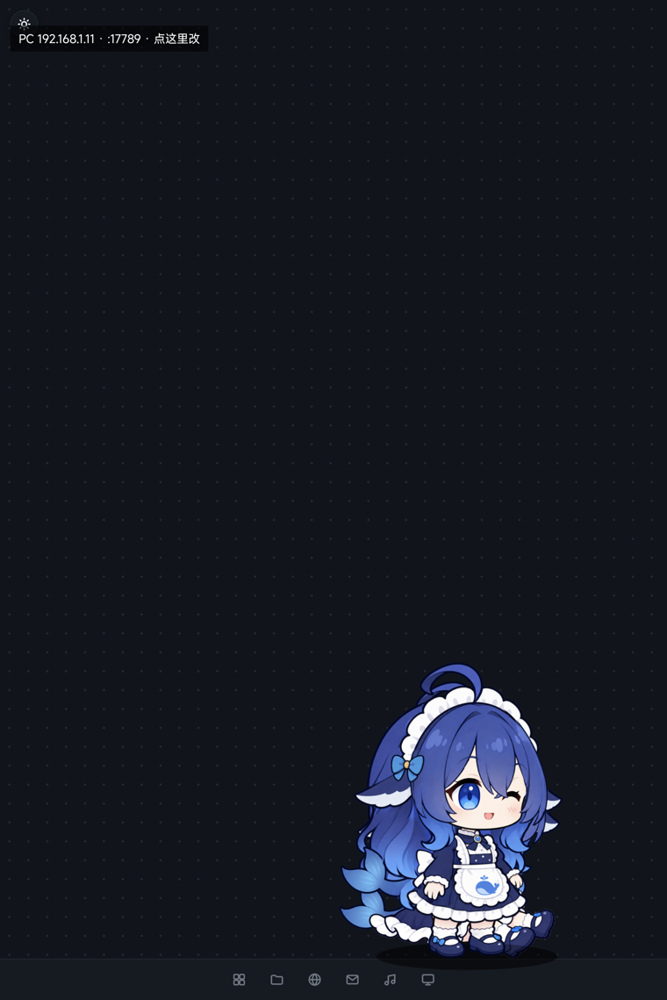
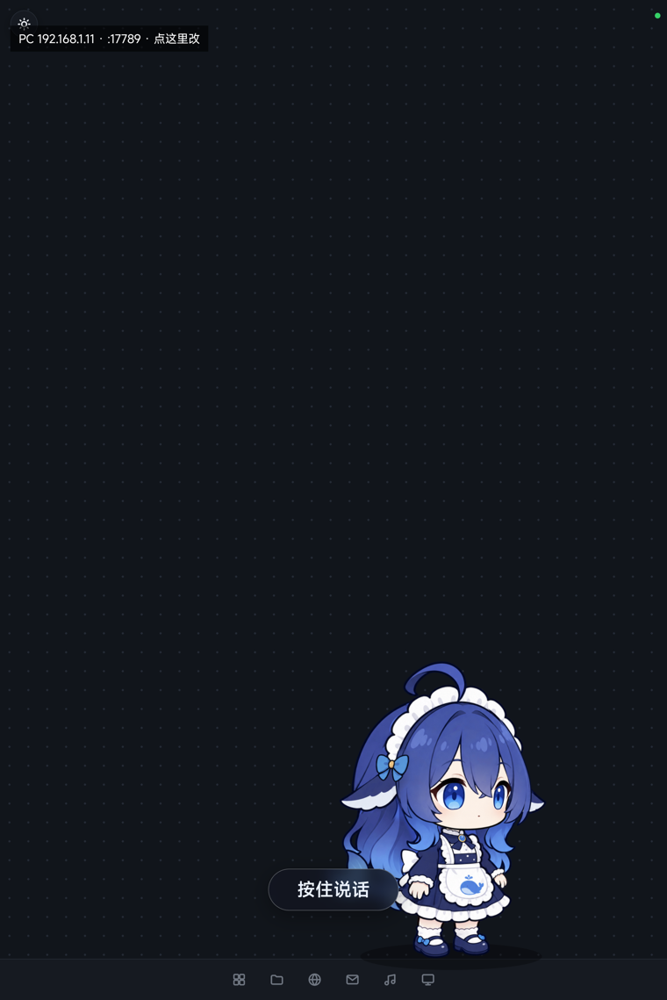

# Coo Mobile — 把 Coopanion 搬到手机/平板（自用，不分发）

> Hermes 2026-10-27 建。工程目录见「三、目录」，PC 上的 Coopanion 本体**一行没改**。
>
> **别把 `android/app/src/main/assets/runtime.tgz` 传出去。** 这个 403MB 的运行时包里
> 带着打包时那个 `home/` 目录 —— 模型 API key（`home/providers/*/config.json`）、
> 全部对话记录（`home/companion/data/runs/*/transcript.jsonl`）、设备标识
> （`telemetry-id`）、自定义头像，都在里面。`.gitignore` 已经把它整个排除了，
> 正常提交带不上去；要发给别人 / 传网盘前，先跑
> `python tools/pack-runtime.py` 生成剔除了这些的 `runtime-clean.tgz`。

<p align="center">
  
  
</p>

## 一、结论先说

Coopanion 是 Electron 桌面应用（AGPL-3.0），**Electron 不能跑在 Android 上**，所以"移植"不是换打包工具，
而是把它拆成两半，各自放在合适的地方：

| 部分 | 现在在哪 | 说明 |
|---|---|---|
| **大脑**（Coo 的对话、记忆、工具、world、提示词） | PC 上原来的 Coopanion | 纯 Node 进程（`core/boot.ts` + tsx），Electron 只是它的壳 |
| **身体**（宠物渲染、气泡、语音输入） | 手机/平板上的 Coo APK | 复用 Coopanion 自带的 `/pet` 网页 + WebSocket，天然支持"浏览器标签页"模式 |

关键发现（决定方案能这么省事）：

1. 宠物页 `/pet` 是**普通网页**，`pet-app.js` 用 `ws://${location.host}/socket` 连接，
   页面在浏览器标签页里也能当 pet 用（代码里 `host=tab` 分支，会画地板）。
2. 但宠物页服务（PetServer，端口 7797）**只绑 127.0.0.1**，且每个请求都校验 Host/Origin 必须是 loopback
   （防 DNS rebinding），所以手机要连它，中间必须有一次"loopback 改写"。
3. `getUserMedia`（麦克风）只在**安全上下文**可用：`http://192.168.x.x` 会被 Chromium 拒，
   而 `http://127.0.0.1` 算安全上下文 —— 这决定了手机端必须做本机反代，而不是直接连 PC。

## 二、架构

```
┌──────────────── 平板 / 手机 (Coo APK) ────────────────┐
│  WebView ── http://127.0.0.1:17789/pet               │
│     │            ▲                                    │
│     │            │ 同源 HTTP + WebSocket              │
│     ▼            │                                    │
│  LocalProxy (Kotlin, 127.0.0.1:17789)                 │
│     │  每个请求改写 Host/Origin → 127.0.0.1:7797      │
│     │  keep-alive→close；WebSocket 原样双向转发        │
└─────┼────────────────────────────────────────────────┘
      │  局域网 TCP（Wi-Fi）
┌─────▼──────────────── PC (192.168.1.100) ──────────────┐
│  lan-proxy.py  :17789  →  127.0.0.1:7797              │
│  （Node 版可换；必须常驻，Startup 里已备自启脚本）      │
│                                                        │
│  Coopanion 核心进程                                    │
│   ├─ PetServer 127.0.0.1:7797  宠物页 + /socket       │
│   └─ Console   127.0.0.1:17788 控制台（模型/插件/设置）│
└────────────────────────────────────────────────────────┘
```

## 三、目录

```
Coopanion-mobile\
├─ tools\
│   ├─ lan-proxy.py          PC 侧 LAN 反代（Python 3，标准库，支持 WebSocket；会重写 CSP 端口）
│   ├─ lan-proxy-stop.bat    停掉反代
│   ├─ startup\Coopanion-LAN-Proxy.vbs  登录时无窗口自启（拷到 Startup 文件夹）
│   ├─ ws-probe.cjs          诊断：模拟手机 ws 客户端，看能否收到 init/watching
│   ├─ cdp.mjs               诊断：手机 WebView 的 CDP 客户端（eval/evalall/type/key/shot/logs/preload/call）
│   ├─ phone-talk-shim.js    手机页面的「按住说话」脚本（由反代追加到 pet-app.js 模块末尾）
│   ├─ fake-mic.js           联调：把麦克风换成测试音频（配合 test-audio/ 与 /__coo/test/ 路由）
│   ├─ test-audio/           联调音源（合成的中文语音 wav）
│   ├─ patches/apply-world-gate.py  Coo 升级后重跑的 world 补丁（case 'gate'）
│   ├─ pet-window.cmdline.txt      让位时记下的桌宠窗启动命令行（归还用，运行时生成）
│   └─ gaming-bridge 相关仍留在 Coopanion 自己的 tools\ 下
├─ android\                  Coo APK 工程（Kotlin，无第三方依赖）
│   └─ app\src\main\java\lab\palailab\coo\mobile\
│       ├─ MainActivity.kt        全屏宠物页 + 麦克风 + 设置菜单（开应用会自动收掉悬浮窗）
│       ├─ OverlayPetService.kt   悬浮窗桌宠（透明、贴底、可切点击穿透）
│       ├─ LocalProxy.kt          手机本机反代（Host/Origin 改写，Origin:null 保持原样）
│       ├─ ProxyHub.kt            本机反代的唯一持有者（全屏页与悬浮窗共用）
│       └─ Prefs.kt               PC 地址等设置
└─ README.md
```

## 四、怎么跑

### PC 侧（一次性）

```bat
rem 常驻反代（宠物页 7797 → 手机可访问的 17789）
python tools\lan-proxy.py --port 17789 --upstream 127.0.0.1:7797
```

自启：把 `tools\startup\Coopanion-LAN-Proxy.vbs` 拷到
`%APPDATA%\Microsoft\Windows\Start Menu\Programs\Startup\`。

前提：Coopanion 正在运行（它自己监听 7797 / 17788）。

### 手机/平板侧

1. 装 APK：`adb install -r android\app\build\outputs\apk\debug\app-debug.apk`
   （重装后要补一句 `adb shell appops set lab.palailab.coo.mobile SYSTEM_ALERT_WINDOW allow`，
   否则悬浮窗会“存在但看不见”，详见「坑」第 9 条）
2. 打开 **Coo**，默认连 `192.168.1.100`（点左上角状态条可改 IP）。
3. 左上角状态条 → 菜单里有"开启悬浮桌宠"（需要先允许"显示在其他应用上层"）。
   悬浮模式下按 Home 回桌面，她会站在屏幕底部；通知栏里有「点击穿透 / 允许戳她」的开关。

### 构建 APK

```bat
cd android
gradle assembleDebug --no-daemon "-Dhttp.nonProxyHosts=*" "-Dhttps.nonProxyHosts=*"
```

> 必须带 `-Dhttp.nonProxyHosts=*`：本机 `~/.gradle/gradle.properties` 里写死了 Clash 代理 127.0.0.1:7897，
> 代理没开时 Gradle 会全部请求失败（报"插件找不到"，实际是 socket 异常）。详见「坑」一节。

## 五、已验证 / 未验证

已验证（2026-10-27 白天 + 晚间）：

- PC 侧：`/pet` 页面、`/api/state`、静态资源经 LAN 反代从局域网访问均 200。
- WebSocket：从局域网侧连 `/socket?role=pet&host=tab` 收到 `{"t":"init",...}` 与 `{"t":"watching"}`。
- APK：编译通过（≈850 KB），已安装到平板（小米 25091RP04C，Android 16 / arm64）。
- **宠物本体渲染**：平板全屏页上鲸鱼女仆正常站立（占屏约 30%，未被裁切）。
- **对话闭环**：平板上打字 → PC 核心 LLM 回话（`data/logs/core.log` 里能看到
  “你好你好～平板上打字过来也照样能听见我”），回落成气泡。
- **麦克风**：`isSecureContext=true`、`getUserMedia({audio:true})` 返回 live 轨道
  （页面从 `127.0.0.1` 加载，属安全上下文）。
- **悬浮桌宠**：AGP 编译的独立进程服务，透明贴底 42% 高，桌面上只剩宠物和气泡，
  地板/模式按钮/工具条都被注入 CSS 藏掉。
- **两种形态切换**：开应用自动收掉悬浮窗（`onResume`），悬浮窗与全屏页共用同一个本机反代
  （`ProxyHub` 引用计数），不会互相抢端口。
- **语音输入（按住说话）**：页面按钮开闸 → 16 kHz PCM 帧 → World 切句 → SenseVoiceSmall 转写 →
  交给 bot 回复，实测转写与测试语音逐字一致（详见「六点六」）。

待验证：

- 真人对着平板说话的识别率（链路是通的，测试用的是合成语音）。
- 长语音/连续对话下的稳定性、耗电。
- 悬浮窗里直接按住说话（按钮在悬浮窗里也有，但还没实机试过手感）。

## 六、坑（都是实测踩出来的）

1. **Gradle 假失败**：`~/.gradle/gradle.properties` 硬编码了 `systemProp.http.proxyHost=127.0.0.1` / 7897。
   Clash 没开时，Gradle 报"Plugin ... was not found"，真正原因是 socket 异常。构建时加
   `-Dhttp.nonProxyHosts=* -Dhttps.nonProxyHosts=*`，或先开 Clash。
2. **Build Tools 版本**：AGP 8.7.3 默认要 34.0.0，本机只有 35.0.0，已在 `app/build.gradle.kts` 里显式指定。
3. **MIUI/HyperOS 的 `Error type 3`**：`adb install` 成功、`pm dump` 里能看到 Activity，
   但 `am start` 报 `Activity class does not exist`。这是 MIUI 对新装外部 APK 的已知行为，
   **在桌面点一次图标**即可（之后 `am start` 正常）。
4. **同一时刻只有一个 pet 连接**：全屏页和悬浮窗各占一个，会互相顶掉（服务端 `4000 replaced`）。
   开悬浮窗时先把全屏页置空；反过来，从桌面点图标回到应用会自动收掉悬浮窗（`MainActivity.onResume`）。
5. **PC 的 IP 会变**（DHCP）：换网络后点状态条改地址；`192.168.1.100` 是 2026-10-27 的值。
6. **`/figure-frame` 的 CSP 把端口写死**：`script-src http://127.0.0.1:7797`。手机页面如果从
   别的端口加载（如 17789），形象包的脚本会被 CSP 拦掉，表现是**宠物本体永远不出现、
   20 秒后报“形象没有准备好”**，控制台那行是
   `Loading the script '.../figure-frame.js' violates ... "script-src http://127.0.0.1:7797"`。
   解法：PC 侧反代 `rewrite_response_head()` 把响应头里的 `127.0.0.1:7797` 改写成客户端端口。
7. **`Origin: null` 不能改写**：沙箱 iframe 的 module 请求带 `Origin: null`，服务器对它回
   `Access-Control-Allow-Origin: null`。反代如果把这个头也改成 loopback，服务器就不回 ACAO，
   figure 脚本被 CORS 拦掉（`from origin 'null' has been blocked by CORS policy`）。两个反代都只改
   非 null 的 Origin。
8. **平板上 7797 已被别的应用占用**（实测 uid 10312，任何路径都回 404），所以**不能**让手机本机
   端口也用 7797 来绕过 CSP —— 只能走第 6 条的响应头重写。
9. **重装 APK 会把 `SYSTEM_ALERT_WINDOW` 重置成 ignore**：`adb install -r` 之后要重新
   `adb shell appops set lab.palailab.coo.mobile SYSTEM_ALERT_WINDOW allow`，
   否则窗口 `isOnScreen=false`、悬浮窗“存在但看不见”（`mAppOpVisibility=false`）。
   MIUI 还可能在你首次尝试时把 op 打回 ignore（`rejectTime=...`），再设一次并重启服务即可。
10. **悬浮窗是独立服务但同进程**：`WebView.setWebContentsDebuggingEnabled` 要在服务里再调一次，
    否则 `adb forward` 过去没有 target。
11. **两个消费者抢同一个反代端口**：以前两边各自 `new LocalProxy`，第二个 bind 失败是**静默**的，
    表现是后来者白屏。现在统一走 `ProxyHub.acquire(host, holder)`。

## 六点五、排障工具

`tools/cdp.mjs` —— 手机 WebView 的 CDP 客户端（用 Coopanion 自带的 `ws`，不需要 npm）：

```bat
adb forward tcp:9333 localabstract:webview_devtools_remote_<pid>
set ELECTRON_RUN_AS_NODE=1
Coopanion.exe tools\cdp.mjs list                       rem 有哪些页面
Coopanion.exe tools\cdp.mjs eval "document.title"      rem 在页面里跑 JS
Coopanion.exe tools\cdp.mjs evalall "location.href"    rem 每个执行上下文（含沙箱 iframe）各跑一遍
Coopanion.exe tools\cdp.mjs type "你好"                 rem 真·输入（trusted 事件）
Coopanion.exe tools\cdp.mjs key Enter
Coopanion.exe tools\cdp.mjs shot out.png               rem 截 WebView 自己的渲染
Coopanion.exe tools\cdp.mjs logs                       rem 听页面 console/log
```

`evalall` 是查“宠物画没画出来”的关键：沙箱 iframe 是独立执行上下文，父页面看不到它的
canvas，但 CDP 能进去查 `document.querySelectorAll('canvas').length`。

## 六点六、语音：平板上的「按住说话」

平板上的语音已经闭环（实测转写文本与测试语音逐字一致：“库洛，我现在在平板上按住说话，
你能听得见吗？”），但它是三块拼起来的，每一块都要知道为什么存在。

**1）为什么必须给 world 打一处补丁**

服务端 PetServer 里有一条硬规矩（server.ts 的 accept）：

```
watcher = role !== 'pet' || (!fromWindow && petConnected && petIsWindow)
```

也就是说 **PC 上那个透明桌宠窗（host=window）优先于任何浏览器/手机页面**。手机页面一旦是
“旁观者”，服务器只放行 `text` / `prefs` / `control` 三种消息 —— 打字发送正常，但**音频帧、
`commit`、`gate` 全被丢掉**。这正是“看起来连着、打字能聊、就是语音没反应”的真凶。

而收音的闸门 `gateOpen()` 只由两件事打开：`asr.mic.mode === 'always'`，或者热键按下的
`talking`。手机没有键盘，页面也没有任何消息能打开它。所以补了一行：

```ts
case 'gate': { if (typeof msg.open === 'boolean') this.setTalking(msg.open); return; }
```

走的是和热键**完全相同**的 `setTalking()`：开闸 → 收音频帧 → 松开 flush → 转写 → 交给 bot。
桌面热键路径一行没动。

补丁脚本（幂等，Coo 升级会覆盖 node_modules，升级后重跑一次并重启 Coo）：

```bat
python tools\patches\apply-world-gate.py           rem 打补丁
python tools\patches\apply-world-gate.py --check   rem 只检查
```

**2）页面怎么长出一个按钮（不改 Coopanion 的前端）**

`tools/phone-talk-shim.js` 由 PC 反代在响应 `/web/pet-app.js` 时**追加到模块末尾**（只对带
`X-Coo-Mobile: 1` 的手机请求这样做，桌面浏览器拿到的还是原封不动的 94 KB）。追加进的是
模块作用域，所以能直接用页面自己的 `send()` 和 `ws`，不用改上游任何一个浏览器端文件。

按钮行为：
- 手机是真正的 pet → **按住说话**（按下发 `gate:true`，松开发 `gate:false`）。
- PC 桌宠窗在当家 → 按钮变 **“电脑在当家 · 点我接管”**，点一下让电脑让位（见下）。

**3）让位 / 归还（PC 反代的三个端点 + APP 菜单）**

`/__coo/petwindow/status|yield|restore`：
- `yield`：记下桌宠窗的命令行（里面有本次运行生成的 `#key=`），结束那个进程；
- `restore`：用记下的命令行重新拉起（`--parent-pid` 会换成当前父进程）。
- 坑：拉起时**必须**把 `ELECTRON_RUN_AS_NODE` 从环境里剔掉，否则 exe 当 node 跑，
  直接 `bad option: --pet-host` 退出（第一次还原失败就是这个原因）。

APP 菜单里对应“让电脑桌宠让位（平板接管语音）”和“让电脑桌宠回来（把 Coo 还给电脑）”。

**4）联调（没有真人说话也能验）**

- `tools/fake-mic.js` + CDP：把 `getUserMedia` 换成播放 `/__coo/test/mic-test.wav` 的
  假音源（反代专门加了这个路由），页面自己的 AudioWorklet、送帧、切句、ASR 全走真代码。
- 注意 `AudioBufferSourceNode` 只能 `start()` 一次：要重复播放，每次都得新建 source
  （否则第二次是静音，看起来像“ASR 坏了”）。
- 极短或纯噪声的片段会被 `looksHallucinated()` 过滤掉，最后文案为空是**正常行为**，不是链路断了。

## 六点七、悬浮窗只在她身上接住点击（2026-10-28）

原来的悬浮窗是「全宽 × 屏幕 42% 高」的一整块矩形，整块都在接点击 —— 于是她能待着的那半块屏幕
等于废了。现在拆成两个窗口：

- **显示窗**：WebView，全宽贴底，永远 `FLAG_NOT_TOUCHABLE`，一个像素都不吃点击。
- **触摸窗**：一个透明 View，只有她身体那么大（`body.layout.box` + 气泡/菜单 + 14dp 余量），
  跟着她走；收到的每个 MotionEvent 用 `dispatchTouchEvent` 投给 WebView
  （坐标按两个窗口的屏幕位置换算），所以她照样能被戳、被拖、被按住说话。

为什么不用 `LayoutParams.touchableRegion`：那是最正统的做法，但 **MIUI/HyperOS 的 framework
把这个字段整个删了**（`getDeclaredField` 直接 `NoSuchFieldException`，`setTouchableRegion`
也 `NoSuchMethodException`），反射无解，所以只能用双层窗口。

页面每 4 帧上报一次命中区（`web/pet-app.js` 的 `reportHitArea()` →
`CooOverlay.setHitArea(json)`），原生取并集后 `updateViewLayout` 触摸窗。

## 六点八、桌宠活动范围（横屏/竖屏各一份）

主界面点左上角状态条 → 「桌宠活动范围（当前竖屏/横屏）」，两个滑块划出她允许走动的横向区间
（屏宽的百分比，横屏和竖屏分开存：`range_portrait` / `range_landscape`）。

- 页面侧：`window.CooRange = {left, right}`，`walk()` 里的目标是**按比例映射进区间**的
  （`mapRange`），被拖出去/扔出去落地后也会被拉回来（`clampRange`），记得的旧位置一样夹到区间内。
- 所以横屏时给她留左边那一段、竖屏时整屏，各设一次就行。

## 六点九、回 App 时悬浮窗必须同步摘掉

`stopService()` 的 `onDestroy` 是异步的：慢一拍她就会在屏幕上多留一会儿（“模型滞留”），
而且旧页面还占着 pet 身份，主界面只能当旁观者。`MainActivity.onResume()` 现在直接调
`OverlayPetService.hideNow(this)`：`removeViewImmediate` 摘窗 + `stopSelf`，然后
`about:blank` 断掉旧连接再重新加载。

## 六点十、左上角状态条的字号

`statusTextSp()`：12sp 基准 ×√(dpi/320)，平板（shortestScreenWidthDp ≥ 600）再 ×1.15，
夹在 13–20sp。440dpi 的平板上是 16.2sp（原来写死 11sp）。

## 六点十一、称呼只有一个字：库

识别器老把「库，我……」补成「库洛，……」，页面在转写进 DOM 前统一纠回来
（`pet-app.js` 的 `HEARD_FIX`），工作区的 `CONSTITUTION.md` 里也写明了她叫「库」。


## 六点十二、面板里的安卓改造（2026-10-28 第二批）

桌面版面板（17788）里有一堆 PC 专属的东西，安卓上永远是红的。`assets/coo-android-panel.js`
在页面加载后把它换掉（幂等轮询，SPA 重渲染也能跟上）：

- 摘掉「桌宠窗口 / 窗口运行时」（要 Electron，平板没有）
- 「在浏览器中查看」→「回到桌宠（全屏）」，走 `CooAndroid.openPet()`
- 补四行本机能用的：悬浮桌宠开关、桌宠大小（0.8–8×）、活动范围、拖动取消语音的距离

桥是 `MainActivity.PanelBridge`（`addJavascriptInterface(..., "CooAndroid")`）。

## 六点十三、模型大小与拖动取消语音

- **大小**：`Prefs.scale`（默认 3.5），页面里 `S = .42 × scale`。面板 +/- 改完即生效，
  主界面和悬浮窗都会被推 `window.CooScale`（`applyHostConfig()` → `applyPrefs({scale})`）。
- **拖动取消语音**：`coo-tap-talk.js` 记录 pointerdown 的位置，按住期间位移超过
  `window.CooDragCancel`（dp，默认 40）就 `gate:false` 并把这次收音作废 ——
  想把她挪个位置不会再说出一句废话。阈值面板可调。

## 六点十四、插件市场为什么是空的（三个坑叠在一起）

1. **npm 根本不存在**：rootfs 里的 node 是精简版，`/opt/node/lib/node_modules` 是空目录，
   `/opt/node/bin/{npm,npx,corepack}` 三个符号链接全是断的 ⇒ 面板 spawn corepack 直接
   `ENOENT`。现在 npm 10.9.2 + corepack 0.36.0 两个 tarball 随 APK 走
   （`assets/coop/{npm,corepack}.tgz`），首次启动解到 `node_modules/`，
   用 `.coop-ver` 标记做版本比对。
2. **corepack 的签名校验过不去**：`Cannot find matching keyid`。core 的启动环境里加上
   `COREPACK_INTEGRITY_KEYS=0`、`COREPACK_ENABLE_DOWNLOAD_PROMPT=0`（env -i 列表里，见 CoreRuntime）。
3. **索引源被墙**：默认 `raw.githubusercontent.com` 在设备上返回 000。
   `POST /api/extensions/index-base` 改到 `https://fastly.jsdelivr.net/gh/Pal-AI-Lab/cortico-extensions@main` 即可。

三处修完后市场正常列出（实测能看到「大肥鱼功能复合包」「cortico-world-qq-final」等）。

## 六点十五、安卓 CUA 接头（让 PC 插件在平板上也能用）

world 的 CUA 引擎是按 `process.platform` 三选一（darwin/linux/win32），平板是 linux，
于是它去调 scrot/xdotool —— 全都失败。接头分两层：

- **Android 侧**：`CuaBridgeService`（无障碍）+ `CuaHttpServer`（只监听 127.0.0.1:18080）
  - `GET /health`、`/size`、`/ui`（读屏树）、`/screen?raw=1`（原始 RGBA）、`/screen?max=1280`（JPEG）
  - `POST /tap`、`/swipe`、`/path`
  - 实测：`/health` → `{"ok":true,"ready":true}`、`/size` → 3200×2136、`/screen` 返回 18KB JPEG
- **proot 侧**：`assets/coop/cua-android.ts` → world 的 `src/cua/engine/android.ts`，
  按 win32.ts 的形状实现（displays/capture/cursor/moveTo/buttonDown/Up/wheel…），
  用一次性 node 子进程做同步 HTTP（rootfs 里没有 curl/wget）。
  `CoreRuntime.patchCuaEngine()` 只在 `engine-child.ts` 的那一行前面插一个判断
  （`COO_ANDROID_CUA`），文件其余部分不动，上游升级也不会被整段覆盖。

所以插件（world / bot 扩展）一行都不用改：它们调的仍是同一套 CUA 工具，
只是"看屏幕、点一下"落在了安卓自己身上。

## 六点十六、第三批：习惯页、1% 步进、归类修正（2026-10-28 夜）

**「习惯」页（`assets/coo-android-panel.js` 注入）**

上游文案里说的「习惯」页 = 三块东西，现在都在桌宠 tab 里做出来了：

- 自主配置权限（off / default / any / custom）+ **11 项逐项勾选**（形象、配色、走动、打呼时长、音效、
  大小、气泡尺寸、字号、夜间模式、悬停按钮、称呼）→ `worlds.desktop-pet.selfAdjustCustom.<key>`
- 马上回应哪些互动（4 档 + 戳/摸/甩出去/放下 勾选）→ `touch.wakeOn` + `touch.wakeKinds`
- 帧率 60 / 120 / 144 / 不限 → `window.frameRate`

坑：这些键上游只在 `config.ts` 的类型里声明、**没注册进 config schema**，POST 会被静默丢弃。
所以在本 fork 的 `config.ts` 里补注册了（`SELF_KEY_TITLES` + `selfAdjustCustom.*` + `wakeKinds`）。
`wakeKinds` 只能是字符串（core 的数组类型走坐标对解析，会报「需要两个数」），
因此 `touchWakes()` 同时收 `"poke,pet"` 与数组两种写法。

**1% 步进**：`config.ts` 里 `window.scale` 的 `multipleOf` 从 .05 改成 **.01**；
面板里那个框是自由输入 `input[type=number] step=0.01`，改完同时写 Android 侧 `Prefs.scale`
与 `config.json`（两边永远是同一个数）。

**归类修正**：面板每个 tab 共用一个 `.sheetbody`，之前我的五行被插进了配置/语音/环境页。
现在只在**有 `.mountrow` 的那一页**（= 桌宠页）插，其它 tab 一个元素都不碰。

**横竖屏溢出**：`bounds()` 里把 `S` 夹到 `(innerHeight * .92) / 256` 以下 —— 放大到 8× 或转成横屏时，
她整个身子也装得下，不会半个飘在屏幕外。

**按住说话的两个数**（都不是挡位，随便填）：

- 拖动距离 `Prefs.dragCancelDp`（默认 40 dp）
- 按住到开始收音的延迟 `Prefs.holdDelayMs`（默认 180 ms）：按下后等这么久才开麦，
  期间松手或挪过拖动距离就作废 —— 这是"拖动误触发语音"的根因（手还没停稳就开麦）

## 七、下一步（按价值排序）

1. **真人试语音**：按住说话说几句，看转写准不准；必要时在电脑的控制台里调 `thresholdDb` /
   换引擎（FunASR ↔ Whisper ↔ Windows 识别）。
2. **手感调优**：平板上宠物尺寸/地板/气泡位置；横竖屏；WebView 缩放。
3. **看手机屏幕（陪玩）**：MediaProjection 抓帧 → 传给 PC 核心的视觉链路（需要一个“手机屏”输入源，
   目前核心只看 Windows 窗口）。
4. **让 Coo 操作手机**：无障碍服务（点击/滑动/读屏），对应核心里的 CUA 工具集。
5. **彻底脱 PC（可选）**：把 Node 核心塞进 APK（nodejs-mobile 或自编 Node for Android arm64），
   要重编 koffi / sherpa-onnx 两个 native 依赖，工作量以周计 —— 只有“离开家也想用”才值得做。

### 六点十七、CUA 端到端跑通：她真的能看屏幕、点手机（2026-10-28）

在面板给她发一句「用 pet_cua_screenshot 看看屏幕」，她截图 1199×800（真屏 3200×2136），
准确说出界面上有什么；再说「点左上角那行设置」，`pet_cua_click {x:290,y:56}` 真的把菜单点开，
她读出了九项菜单文字。**读屏和操作这两条路都验证到结果，不是只通了端点。**

路上有三个坎，缺一个就全废：

1. **工具根本不挂载**。`src/cua/cua.ts` 的 `unsupported()` 是「linux 且没有 `DISPLAY` → noDisplay」，
   proot 里正是这种情况，于是 `cuaOn=false`，11 个 `pet_cua_*` 工具一个都不给 bot。
   补丁：`if (process.env.COO_ANDROID_CUA) return null;`（`assets/coop/cua.ts` → `src/cua/cua.ts`）。
   判据：`/api/tool-schemas` 里应出现 11 个 `pet_cua_*`。
2. **引擎按平台三选一**。`src/cua/engine-child.ts` 里平板上会挑 linux 分支去调 X11 的
   scrot / xdotool。改成 `COO_ANDROID_CUA ? await import('./engine/android.ts') : …`。
   注意**必须整条语句替换**：早先版本只插了半句、少一个右括号，esbuild 直接报
   `engine-child.ts:23:104 ERROR: Expected ")"`。补丁的「已改过」判断也要连
   `const os: … = ` 一起匹配，否则坏版本会被误判成好的而跳过。
3. **esbuild 没有 arm64 二进制**。esbuild 本体只是外壳，真二进制在 `@esbuild/linux-arm64` 包里，
   rootfs 里没有 → 引擎一 spawn 就 `TransformError`。已把 4.2 MB tarball 打进 `assets/coop/`，
   `ensureCuaEsbuild()` 按 esbuild 版本号解出、`chmod 755`。

另外：给页面发消息不需要真点 UI，也别指望双击（WebView 里双击会被当成缩放）——
`#tools` 第一个按钮就是打字框，`form.b-own` 派发一次 `submit` 即可。

### 六点十八、连着看屏幕、习惯独立页、系统语音（2026-10-28 深夜）

**一、连续看屏幕：可以。**

两件事分开说：

- **引擎连拍**：`capture()` 连发 6 次，1.89 张/秒，零失败（安卓无障碍的 `takeScreenshot`
  没有想象中那么强的节流）。所以「连着看」在工具层没有墙。
- **她自己连拍**：`pet_cua_wait {seconds:1}` 的返回里**带一张新截图**，所以她连看三眼的
  自然写法就是 `screenshot` → `wait 1s` → `wait 1s`，一次调用拿一张。实测她真的这么干了：

  ```
  19:03.102 pet_cua_screenshot {}
  19:05.483 pet_cua_wait {"seconds": 1}   → 带截图
  19:07.296 pet_cua_wait {"seconds": 1}   → 带截图
  19:08.522 pet_cua_wait {"seconds": 1}   → 带截图
  ```

  她的结论：「三张都截了。画面基本没动……只有头上的字在变——第一张写着「在查看屏幕」，
  后两张都变成「在等待 · 1 秒」，还有那串 Z 往上飘了一格。」三张截图正好卡在气泡文字的
  时间轴上，这不是背台词，是真的一帧一帧在看。

**二、「习惯」升成独立一页。**

原来她是塞在「桌宠」tab 最下面的一块；现在左侧栏「桌宠」下面多一项「习惯」，
点进去是整页。页面用面板自己的 `.sheetbody` + `.mountrow`，视觉和别的页一致；
行尾 `.mstate` 直接显示当前值（自定义 / 按勾选 / 60 / 开着 · 引擎：…），改完立刻变，不用刷新。
八行：自主配置权限、她能自己改的 11 项、马上回应哪些互动、帧率、系统语音开关、语速、音高、试听。

**三、系统语音：她现在真的会出声了。**

`TtsSpeaker`（单例，主界面和悬浮窗共用），`pet-app.js` 每显示一句话就调
`CooAndroid.speak()`，舞台上那些【点头】标记会被剥掉只念字。实测她的原话：

```
E/TtsService: onSynthesizeText Start: text=三张都截了。画面基本没动：左上还是「本机核心…」，库。
```

这里有一个必须记住的坑：**Android 11 起查别人的服务要先声明包可见性**，
`AndroidManifest.xml` 里少了

```xml
<queries><intent><action android:name="android.intent.action.TTS_SERVICE" /></intent></queries>
```

的话，`TextToSpeech` 一个引擎都看不见，初始化直接返回 `-1`，日志看起来像「系统没有语音引擎」，
其实是自己没申请去看。补上这一段就好了（这台平板上用的是 `com.xiaomi.mibrain.speech`）。
小爱引擎还会在 logcat 里留下 `AppsFilter BLOCKED`，那是 MIUI 的应用隔离刷屏，**不是**失败原因。

**四、两个和她说话的路子，别走错：**

- **老大通道（正常）**：点 `#tools` 第一个按钮 → 气泡里 `form.b-own textarea` → 提交，
  消息以「老大:」进来，她照做。
- **面板「控制台」通道**：消息会被标成「控制台:」，而她认「控制台」是要口令的；
  口令为空或 webui 没把 `[console|PIN:…]` 带上时，她会明确拒绝执行并等你点头——
  我试过在正文里手写 PIN，她照样识破。**这是她该有的警惕，别当成 bug 去绕过。**

还有一点：面板和桌宠页是同一个 WebView，**面板开着的时候桌宠页就断了**，
这时她的 `pet_say` 会报「桌宠窗口没有连接」。她自己说话要有人接，就把页面停在桌宠页。

## 六点十九、实时看屏幕、语音引擎自动检测、入口改版（2026-10-28 深夜）

上一版说「连着看屏幕」只是**截图 + 等待的循环**（约 1.9 张/秒，每张还要等系统慢慢合成）。
这一版换成真正的实时流，顺带解决另外两件事。

**一、实时看屏幕：MediaProjection 持续抓，8 帧/秒**

新增 `ScreenStream.kt`（`ScreenStream` 单例 + `ScreenStreamService` 前台服务）：

- `MediaProjectionManager` 授权一次 → `VirtualDisplay` 半分辨率镜像（1068×1600 或 1600×1068）
  → `ImageReader` 出 RGBA → 节流到 8 帧/秒 → 最近一帧留在内存。
- CUA 接头多三个端点：`/live`（帧率/帧数/帧龄）、`/frame`（最新一张 JPEG）、
  `/stream`（`multipart/x-mixed-replace`，浏览器直接能看视频）。
- `screenshot` 现在**优先取实时帧**：引擎那条路从 **500ms 掉到 20–25ms**，快 20 倍。

量到的数字：7.4–7.5 帧/秒、最新帧龄 42–114ms、`/frame` 单次 41–54ms、`/stream` 按 `?fps=`
推流（默认 4）。

**二、`pet_cua_watch`：一次看一小段，而不是看一眼**

新工具（`assets/coop/cua-tools.ts` + `cua.ts` 的 `watch()`），参数 `seconds`(0.5–10) 和
`frames`(2–4)，把这段时间里抓的几张图**一起**交回去，她自己排时间顺序。

实测她第一次就选中了这个工具，看的是自己的动画：

```
CALL pet_cua_watch {"frames": 3, "seconds": 2}
SAY 【点头】动的是我自己，库：第一张我闭眼笑，第二张眼睛眯着往下看，
     第三张眼睛睁开朝右边瞧，头发和尾巴也晃了一点。别的都没动……
```

单张截图是绝对看不出「眨眼 → 眯眼 → 睁眼」这个过程的。这才是「实时看屏幕」该有的样子。

**三、语音引擎自动检测（换任何品牌机型都能自己找）**

`TtsSpeaker.kt` 的 `init()` 不再依赖系统默认引擎，改成探测链：

1. 先用系统默认；
2. 不成功就从 `<queries>` 里枚举设备上所有 TTS 引擎（`queryIntentServices(TTS_SERVICE)`）逐个试；
3. 每个都先验中文能力（`setLanguage(zh)` 不返回 `LANG_MISSING_DATA`/`LANG_NOT_SUPPORTED`）；
4. 中文引擎找不到就退回「能出声的」那个，并如实报「不会中文」；
5. 一个都没有才报「这台设备上没有能用的语音引擎」。

日志：`系统语音就绪：engine=com.xiaomi.mibrain.speech voice=zh 中文=true`。
小米、华为、三星、讯飞各有自己的引擎包名，这套链子不需要按品牌写死。

**四、左上角入口：从一行小字改成会招手的胶囊**

- 文案：没点过是 **「👋 点这里进设置」**，点过一次之后变 **「⚙ 设置面板」**（`Prefs.entrySeen`）。
- 视觉：近黑底 + 亮紫 2dp 描边 + 圆角胶囊 + 加粗，字号按 dpi 和屏幕尺寸算（16–26sp，
  平板再 ×1.15）。这块实测在平板上是 **584×145 px**。
- 动效：没点过时一直呼吸（alpha 1↔0.5，700ms），点过之后只在刚进桌宠页时轻提醒 5 下就停，
  不长期闪。状态条颜色也改了：核心没响应时整个胶囊变红（`⚠ 核心没响应 · 点这里看/重启`）。

**这一轮踩到的坑（都不浅）：**

- **MIUI 开无障碍要过两道确认框**，而且 `settings put secure enabled_accessibility_services`
  **完全无效**（写进去也会被系统清回 `null`）。正确路径：设置 → 通用 → 已下载的应用 →
  Coo → 开关 → 第一道「确定（6）」等倒计时 → 第二道要点**勾选框**再点「确定」。
  第一道框里「取消」在左半边、确定在右半边，点错位置会静默什么都没发生。
- **MediaProjection 屏幕静止时不出新帧**——`VirtualDisplay` 是画面变了才推。
  我一开始把「3 秒没新帧」判成「流断了」，导致屏幕一静下来 `screenshot` 就退回 500ms 的
  无障碍慢路径。改法：`running` 只看会话是否活着（`started` 标志），帧龄单独用 `ageMs`。
  现在静止两分钟也是 `running:true`，那一帧就是当前画面。
- **重装 APK 后投屏授权必然失效**（Android 14 起每次会话都要重新同意）。面板里点「开启」
  会弹授权；`tools/` 那边有 `screen_on.py` 可以自动点完整个弹窗，不用人动手。
- **`/size` 那次 `no-size`** 是瞬时失败（无障碍刚绑定、`svc` 还没就绪），不是实时流的锅；
  她那边报错信息里带 `android-bridge:` 前缀的都是引擎侧的。

## 六点二十、能不能开一小时？——长跑实测与三个硬限制（2026-10-28）

老大直接问的：「实时看屏幕能一直看吗？比如看一个小时」。答案分三层，都实测过。

**一、根本问题：原来每秒产生 54MB 垃圾**

`onFrame` 每帧 `ByteArray(6.8MB)`，8 帧/秒 = 每秒 54MB、一小时 190GB 分配量。
实测改造前 dumpsys `Java Heap 31.5MB / 54MB`，改造后 `33–34MB / 54MB` —— **堆占用几乎没变**，
因为新方案本身就是 3×6.8MB ≈ 20MB 的常驻缓冲。

所以收益不在省内存，而在**分配速率从 54MB/s 归零**：不再有每秒 54MB 的垃圾要 GC 收，
CPU 不用一直替 GC 打工。心跳口径是 `Runtime.totalMemory() 23–24MB / maxMemory 256MB`（9%）。

改法：三块**轮转复用**的缓冲（写一块、最新一块、可能正被读的一块互不重叠），
每块前面留 8 字节放宽高头（和 `/screen?raw=1` 同格式），`rgba()` 直接把那块交出去、不拷贝；
`/frame` 用的 Bitmap 也复用。日志会打「缓冲 3×6MB 复用」。
稳态每帧分配为零，之后只占那 20MB 常驻。

**二、硬限制：屏幕一灭，投屏必断（Android 14 起，改不了）**

实测：屏幕亮着 7.5 帧/秒，`frames` 141；按熄屏 18 秒后 **`frames` 归 0**，日志
「投屏会话被收回（不是屏幕关了，是屏幕不可见就不许投射）」。亮屏**不会自动恢复** ——
重新投屏必须再弹一次系统同意框，这是防偷录的，任何 App 都一样。

所以「挂一小时」的真实条件是**屏幕一直亮**。给了两个对策：

- 面板新增 **「屏幕别灭」**（`A.setKeepOn`，`Prefs.screenKeepOn`）→ `FLAG_KEEP_SCREEN_ON`。
  默认关，因为亮屏更耗电，由用户自己选。
- 会话被收回时发一条可点通知（`notifyLost()`，`NID+1`），点回 app 后 `onResume`
  检测到「还想要但没在跑」就**自动把授权框再弹一次**，点一下就恢复。
  用户上次点过取消则 `screenWant=false`，不再反复弹。
  日志链：`投屏该恢复了 → 自动恢复：isFinishing=false → 请求投屏授权框`
  → 前台确实变成 `MediaProjectionPermissionActivity`。

**三、加固：心跳 + 省电白名单**

- 每 60 秒一行心跳：已跑秒数 / 总帧数 / 实时帧率 / 帧龄 / 堆用量。长跑排查全靠它。
- `adb shell dumpsys deviceidle whitelist +lab.palailab.coo.mobile` 加进省电白名单，
  降低被 MIUI 清掉后台的概率。
- `START_NOT_STICKY` 是对的：进程被杀了没有 projection token，重启也接不回来，
  不如让用户点一下。

**这一轮还顺手修了两个真 bug：**

- `running` 不能用「最近 3 秒有帧」判断 —— 屏幕静止时系统本来就不推新帧。
  改成看会话标志 `started`，帧新鲜度另用 `ageMs()`。否则屏幕一静止截图就退回 500ms 慢路径。
- `screen_on.py` 的授权弹窗按钮在不同 Android 版本叫法不同（14 叫「共享屏幕」，
  更早叫「下一步」），而且「应用范围」会记住上次的选择（已整屏就不用再展开）。
  脚本现在两个都认。

## 六点二十一、「习惯」从整屏浮层改成和其他栏一样的嵌入式页（2026-10-28）

老大反馈：「点『习惯』这一栏时会直接出现『习惯』页面的全屏，有点割裂了，改成和其他栏一样的吧」。

**原来错在哪**：习惯页是 `position:absolute; top/right/bottom/left:0; z-index:30` 的一层浮层，
盖在面板上；而且被 `appendChild` 进 `#kernel-root.lastElementChild` —— 那是面板**当时隐藏着**的视图容器。
所以点它像"跳到另一个页面"，字号、边距、滚动条全跟旁边的栏不一套。

**面板真实结构**（CDP 摸出来的）：

```
body
 ├ #rail          侧栏，a.navitem × 13
 └ #kernel-root   内容区，children 是**并列的视图**，靠切 display 换页
     ├ div (flex)  ← 当前显示的视图
     │   ├ .providerchrome > header.featureintro.providerintro
     │   └ .panelslot > .sheet.tabbed > .sheetbody
     └ div (none)
```

**改法**：不再自绘浮层，直接照面板的骨架造一个并列视图：

```js
div#coo-habit-page (display:none; flex-direction:column; width/height:100%)
  .providerchrome > header.featureintro.providerintro > h1「习惯」+ p 副标题
  .panelslot > .sheet.tabbed > .sheetbody   ← 8 行设置都在这里
```

进这一栏时把**当前在显示的那个视图** `display:none`，自己 `display:flex`；退出去再还原。
class 直接复用面板的，所以字号、行距、分隔线、滚动条自动跟其他栏一致。

**尺寸实测对齐**（同一台设备、同样竖屏）：

| | 桌宠栏 | 习惯栏 |
|---|---|---|
| 视图 | 567×1164 @ x=210 | 567×1164 @ x=210 |
| 标题区 | 567×198 | 567×138（桌宠多一条工具条，属正常） |
| 内容槽 | 567×966 @ y=198，overflow:auto | 567×1026 @ y=138，overflow:auto |
| sheetbody | 507×851 @ x=240 | 507×1019 @ x=240 |

**踩到的坑**：还原时把记录下来的 `display` 直接写回 inline，结果面板那一栏**白屏**了 ——
面板自己的显示是靠 class 的，写死 `display:none` 会一直压着它。改成
`orig ? el.style.display = orig : el.style.removeProperty('display')` 才对。
另外只压"当时真在显示"的那个视图，本来就藏着的别碰，减少跟面板抢状态。

来回切四轮验证：习惯 → 桌宠 → 习惯 → 控制台，每次 `#kernel-root` 里可见视图数都是 1，无残留、无重叠、无白屏。

**后续两个小 bug（同日修掉）**：

1. **侧边栏「习惯」一直亮着** —— 这个 `.active` 是我们手动加的，切走时只还原了内容没摘高亮，
   点别的分类它还在亮，看着像没切过去。修法：`showHabit(false)` 里 `habitNav.classList.remove('active')`。
   注意面板自己的高亮是靠路由给的，所以摘掉我们那份、留它那份，正好。
2. **连点两次「习惯」再切走可能白屏** —— 第二次点击会把 `hidViews` 清空（那时别的视图本来就是 `none`，
   被"只记真在显示的"条件跳过了），于是切走时没东西可还原。修法：已经在习惯页就直接 return，不重跑。

八轮切换验证（含连点两次）：习惯 / 桌宠 / 习惯 / 控制台 / 习惯 / 习惯 / 桌宠 / 应用通知，
每一步高亮都只有点中的那一项，可见视图始终为 1。

## 六点二十二、应用改名 Coopanion（2026-10-28）

老大最后一句：「把应用名字改成 Coopanion 吧，与原应用保持一致」。

只改**显示名**，包名 `lab.palailab.coo.mobile` 一个字节没动 —— 动包名等于换了个应用，
数据目录、无障碍授权、投屏授权、电池白名单全要重来一遍。

改到的位置：

- `res/values/strings.xml`：`app_name` = `Coopanion`（桌面图标名就读这个）
- 同文件 `cua_service_label` = `Coopanion · 安卓 CUA 接头`，`cua_service_desc` 首句同步
- `ScreenStream.kt` 通知标题：`Coopanion 正在看着屏幕`
- `MainActivity.kt` 三处：快捷菜单 `Coopanion · 手机版`、面板菜单 `Coopanion · 本机版（17788）`、
  面板状态条 `Coopanion 面板 · 127.0.0.1:17788 · 点这里返回`

**故意没改**的：包名、Kotlin 类名、日志 TAG（`CooMobile` / `CooWeb` / `CooScreenSvc`）、
JS 接口名 `CooAndroid`、`Prefs` 文件名 `coo`、通知渠道 ID、图标资源名 `ic_coo`。
这些是内部标识，改了会动到已落盘的数据和已授予的权限，一点好处没有。

另外留了一处 Coo：快捷菜单里「把 Coo 还给电脑」—— 那是**角色名**（她叫 Coo），不是应用名。

验证：

```
aapt dump badging app-debug.apk | grep application-label
    application-label:'Coopanion'

adb shell dumpsys accessibility | grep Coopanion
    Service[label=Coopanion · 安卓 CUA 接头]
    WindowInfo[title=Coopanion, ...]     ← 任务列表里显示的就是这个
```

## 八、许可

Coopanion 是 AGPL-3.0-or-later。自用、不分发没问题；一旦分发给别人（包括放到应用商店、
或者对外提供服务），整个衍生作品都要按 AGPL 开源。