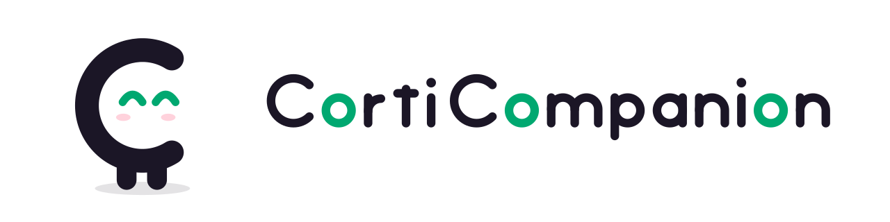
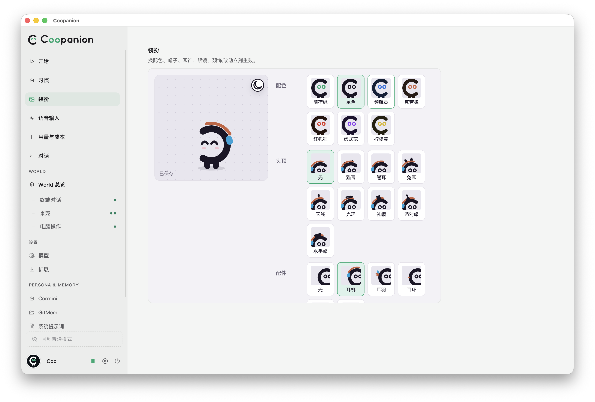
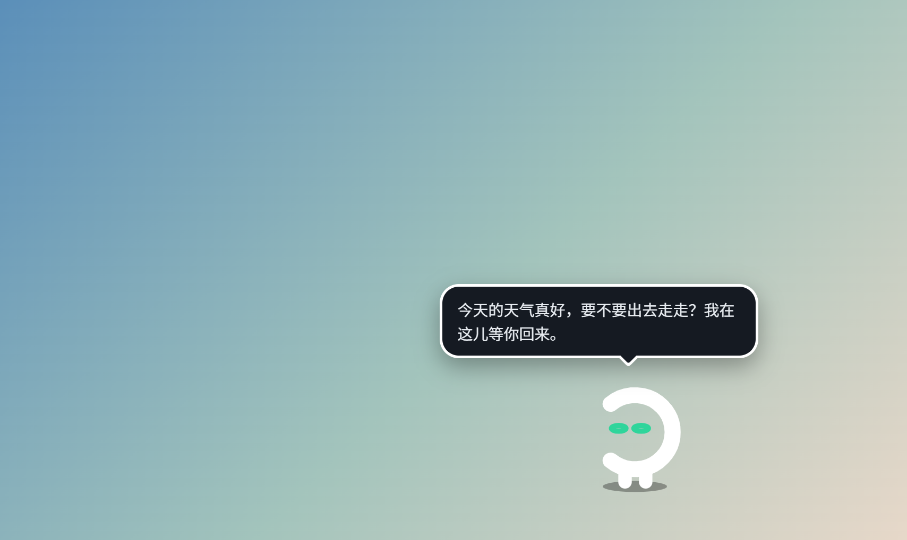
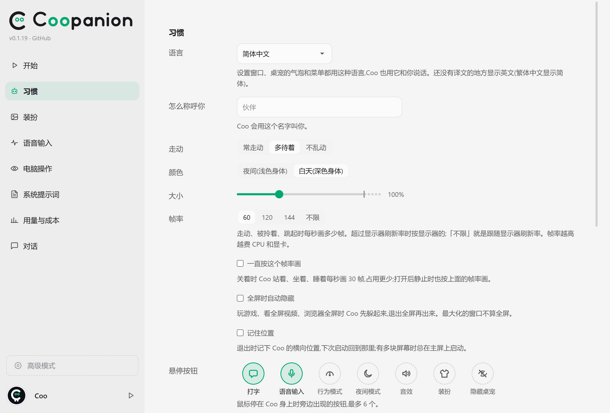
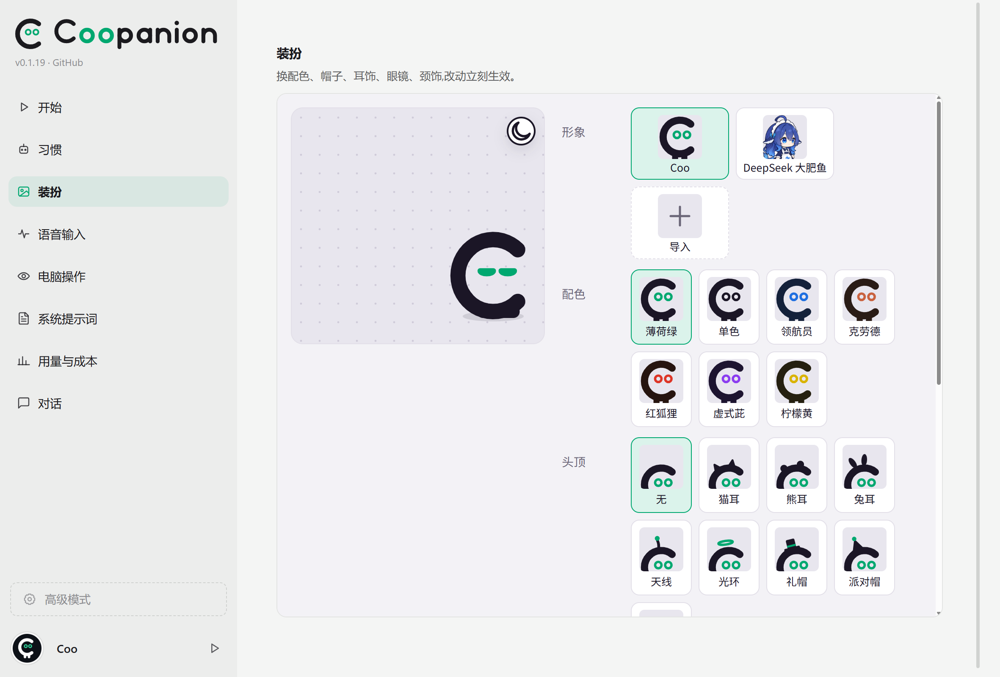

<p align="center">
  <picture>
    <source media="(prefers-color-scheme: dark)" srcset="assets/banner-dark.svg">
    
  </picture>
</p>

<p align="center">
  <a href="README.md">English</a> ｜
  简体中文
</p>

<p align="center">
  <a href="https://github.com/Pal-AI-Lab/Coopanion/releases/latest"></a>
  <a href="https://github.com/Pal-AI-Lab/Coopanion/actions/workflows/ci.yml"></a>
  
  
  
  <a href="LICENSE"></a>
</p>

<p align="center">
  <a href="https://coo.palailab.org">官网</a> ｜
  <a href="#安装">安装</a> ｜
  <a href="#快速上手">快速上手</a> ｜
  <a href="#日常使用">日常使用</a> ｜
  <a href="#费用与隐私">费用与隐私</a> ｜
  <a href="#常见问题">常见问题</a> ｜
  <a href="#社区">社区</a> ｜
  <a href="https://github.com/Pal-AI-Lab/Coopanion/releases">更新记录</a> ｜
  <a href="docs/DEVELOPMENT.md">参与开发</a>
</p>

Coopanion 是一个桌宠。桌宠 **Coo** 待在屏幕底边，可以用气泡和你聊天、听你说话、在底边走动，经你同意后还能操作电脑。支持 Windows、macOS 和 Linux。

**语言**：应用和新手引导有简体中文、繁體中文、English、日本語、한국어、Français、Deutsch、Español (Latinoamérica)、Português (Brasil)、Italiano、Русский 11 种语言。新装时跟随系统语言，系统语言不在其中时用英文；在「习惯」页的「语言」里修改。Coo 用应用语言和你说话。



<p align="center"></p>

## 功能

- **多家模型**：DeepSeek、通义千问、Kimi、智谱 GLM、豆包、MiniMax、阶跃星辰、百度千帆、OpenRouter、OpenAI、Anthropic、Gemini、xAI。选一家，贴上 API Key 就能用；也可以登录 ChatGPT 账号，使用它的 ChatGPT 套餐。
- **聊天**：按说话键说话，或者打字，Coo 在气泡里回复。语音在本机用 FunASR 或 Whisper 识别。
- **记忆**：记得聊过的内容，也知道你戳了它、摸了它的头。它对你的了解写在工作区的 `PARTNER.md`，工作区每次改动都记成一个版本（Windows 版自带 git，macOS 和 Linux 要系统里装有 git）。
- **操作电脑**：点按钮、打字、切窗口。动手前先问你。
- **状态气泡**：想事情、看文件、搜索、写入、操作电脑时，头顶用小图标和动画显示在做什么。
- **形象**：Coo，或者 **DeepSeek 大肥鱼**（全动态的鲸鱼娘，八套厂商配色，三套服装）。其他形象包在「装扮」页导入（见[形象包兼容承诺](packages/cortico-world-desktop-pet/README.md#形象包兼容承诺)）。
- **装扮**：Coo 的配色（含灯、杯、铸、心、冬五种「性相」配色）、帽子、耳饰、眼镜、颈饰，以及大小和走动频率。
- **闹钟**：可以请 Coo 在当地某个时间或若干分钟后设定闹钟。
- **扩展**：在「World 扩展 → 扩展市场」安装 QQ 机器人、画室、小游戏等 World。
- **OBS 画面**：把 Coo 和气泡作为透明背景的 OBS「浏览器」来源。

每个版本的改动见 [Releases](https://github.com/Pal-AI-Lab/Coopanion/releases)。

## 安装

需要：

- Windows 10 / 11（64 位）、macOS 13 及以上（Apple 芯片和 Intel 都可以），或 64 位 Linux 桌面（X11，或 Wayland 下的 XWayland；语音识别要 glibc 2.32 及以上，即 Ubuntu 22.04、Debian 12 起）；
- 一家模型服务的 API Key，按用量付费（见[费用与隐私](#费用与隐私)），或者一个有套餐的 ChatGPT 账号。

安装不需要管理员权限。

### Windows

- **安装包**：在[最新发布](https://github.com/Pal-AI-Lab/Coopanion/releases/latest)下载 `Coopanion-Setup-版本号.exe` 并运行。安装包没有数字签名，Windows 可能弹出「Windows 已保护你的电脑」，点 **更多信息** → **仍要运行**。选安装位置（默认 `C:\Users\你的用户名\Coopanion`）。程序和它的数据都在安装目录里，开始菜单里没有它，从桌面图标打开。
- **一行命令**：在 PowerShell 运行

  ```powershell
  irm https://raw.githubusercontent.com/Pal-AI-Lab/Coopanion/main/installer/install.ps1 | iex
  ```

  如果杀毒软件中途拦下图形界面安装，下载的安装包会保留并打印路径。可以用 `Coopanion-Setup-版本号.exe /S` 静默重装，或先把 Coopanion 加进杀毒软件的白名单。
- **便携版**：在[最新发布](https://github.com/Pal-AI-Lab/Coopanion/releases/latest)下载 `Coopanion-版本号-win-x64-portable.zip`，解压到任意文件夹，运行 `Coopanion.exe`。数据在这个文件夹的 `data` 里。把整个文件夹复制一份就是另一只，记忆和设置各管各的；安装版和便携版加在一起同时最多开 5 只。便携版不会自动更新：升级时把新版解压到一个新文件夹，再把旧的 `data` 复制过去。

### macOS

1. 在[最新发布](https://github.com/Pal-AI-Lab/Coopanion/releases/latest)下载 `Coopanion-版本号-mac-arm64.dmg`（Apple 芯片）或 `…-mac-x64.dmg`（Intel），打开后把 Coopanion 拖进「应用程序」。
2. 应用没有 Apple 开发者签名，第一次打开会被拦下：先打开一次，在提示里点「完成」；再到「系统设置 → 隐私与安全性」，点「仍要打开」并输入密码确认。
3. 图标在屏幕顶部的菜单栏里，打开设置窗口时才出现在程序坞。

App Store 在前台时，Coo 会退到其他窗口后面，以便用触控 ID 确认 App Store 的购买。

> [!NOTE]
> 第一次用到时，macOS 会分别询问麦克风（语音输入）、输入监控（说话键）、录屏与系统录音和辅助功能（操作电脑）。改了后三项之后要重启 Coopanion。更新后 macOS 不把这几项授权算给新版本：开关开着却提示没有权限时，用「−」把 Coopanion 移出那个列表，再把 `/Applications/Coopanion.app` 加回来并重启。

### Linux

1. 在[最新发布](https://github.com/Pal-AI-Lab/Coopanion/releases/latest)下载 `Coopanion-版本号-linux-x64.deb`（Debian / Ubuntu）或 `Coopanion-版本号-linux-x64.AppImage`（其他发行版）。
2. deb：`sudo apt install ./Coopanion-版本号-linux-x64.deb`。AppImage：`chmod +x Coopanion-*.AppImage` 后运行；Ubuntu 22.04 及以后要先装 `libfuse2`（`sudo apt install libfuse2t64`）。

> [!NOTE]
> 桌宠是透明置顶窗口，需要桌面开启窗口合成（GNOME、KDE 默认开启）。托盘图标需要桌面支持状态栏图标（GNOME 要装 AppIndicator 扩展）；没有托盘时右键 Coo 也能进设置。操作电脑要用 `xdotool` 和 `zenity`，deb 会自动安装；Wayland 下截屏还需要 `grim`、`spectacle`、`scrot` 或 ImageMagick 之一。

## 快速上手

1. **启动**：Coo 落到屏幕底边，任务栏（Mac 是菜单栏，Linux 是状态栏）多出一个图标，不弹窗口。
2. **引导**：Coo 在气泡里带你完成设置：怎么称呼你、Coo 的性子、走动频率、用哪家模型服务，以及下载语音识别模型（从 ModelScope 下载；FunASR 约 230 MB，应用语言是法、德、西、葡、意、俄语时是 Whisper，约 360 MB）。点气泡上的 × 可以结束引导，在「开始」页点「使用向导」重来。引导结束后，可以直接和 Coo 商量它的性格和说话方式，它能自己把人设写进提示词。
3. **说第一句话**：快速按一下**左 Alt**（Mac 是**左 Option**），紧接着按住，说「你好」，松开发送。询问麦克风权限时选允许。

<details>
<summary><b>怎么拿到 API Key？</b></summary>

在 Coo 的气泡或「开始」页选一家服务，去它的平台创建 API Key（DeepSeek 还要先充值），贴进去即可。

| 服务                   | 申请 Key                                                                                                                                                                         | 默认模型                                                                   |
| ---------------------- | -------------------------------------------------------------------------------------------------------------------------------------------------------------------------------- | -------------------------------------------------------------------------- |
| DeepSeek               | [platform.deepseek.com](https://platform.deepseek.com/api_keys)                                                                                                                  | `deepseek-flash`                                                           |
| 通义千问（阿里云百炼） | 国内 [bailian.console.aliyun.com](https://bailian.console.aliyun.com/cn-beijing/model/settings/api-key)，国际 [modelstudio.console.alibabacloud.com](https://modelstudio.console.alibabacloud.com/ap-southeast-1/model/settings/api-key) | `qwen3.8-flash`                                                            |
| Kimi（月之暗面）       | 国内 [platform.kimi.com](https://platform.kimi.com/console/api-keys)，国际 [platform.kimi.ai](https://platform.kimi.ai/console/api-keys)                                          | `kimi-k3`                                                                  |
| 智谱 GLM               | 国内 [bigmodel.cn](https://bigmodel.cn/usercenter/proj-mgmt/apikeys)，国际（Z.ai）[z.ai](https://z.ai/manage-apikey/apikey-list)                                                  | `glm-5.3-flash`（国内平台连不上就换成 `glm-5.3`）                          |
| 豆包（火山方舟）       | [ark.volcengine.com](https://ark.volcengine.com/region:cn-beijing/apikey)                                                                                                        | `doubao-seed-2-1-lite-260915`（要先在方舟控制台「开通管理」里开通）        |
| MiniMax                | 国内 [platform.minimax.cn](https://platform.minimax.cn/user-center/basic-information/interface-key)，国际 [platform.minimax.io](https://platform.minimax.io/user-center/basic-information/interface-key) | `MiniMax-M3`                                                               |
| 阶跃星辰               | [platform.stepfun.com](https://platform.stepfun.com/interface-key)                                                                                                               | `step-3.7-flash`                                                           |
| 阶跃 Step Plan         | [platform.stepfun.com](https://platform.stepfun.com/interface-key)                                                                                                               | `step-5-preview`（扣 Step Plan 套餐额度）                                  |
| 百度千帆               | [console.bce.baidu.com](https://console.bce.baidu.com/iam/#/iam/apikey/list)                                                                                                     | `glm-5.3-flash`                                                            |
| OpenRouter             | [openrouter.ai](https://openrouter.ai/settings/keys)                                                                                                                             | `deepseek/deepseek-v4.1-flash`                                             |
| OpenAI                 | [platform.openai.com](https://platform.openai.com/settings/organization/api-keys)                                                                                                | `gpt-6-luna`                                                               |
| Anthropic              | [platform.claude.com](https://platform.claude.com/settings/keys)                                                                                                                 | `claude-haiku-5-5`                                                         |
| Gemini（Google AI Studio） | [aistudio.google.com](https://aistudio.google.com/apikey)                                                                                                                    | `gemini-3.5-flash-lite`                                                    |
| xAI                    | [console.x.ai](https://console.x.ai/team/default/api-keys)                                                                                                                       | `grok-4.3`                                                                 |

默认模型是每家快、便宜且能看图的一档；要换别的，在「开始」页的「模型」框里改模型名。通义千问、Kimi、智谱 GLM、MiniMax 各有国内和国际两个平台，账号和 Key 不通用，可以在「开始」页切换。豆包、百度千帆、阶跃星辰、阶跃 Step Plan 只收中国大陆账号。拿真实 Key 测过的只有 DeepSeek、Anthropic 和阶跃 Step Plan，其他几家连不上请开 issue。

**ChatGPT** 不用 Key：选它，点「使用 ChatGPT 继续」，在打开的浏览器里登录。Coo 的请求计入这个账号的 ChatGPT 套餐用量并受套餐的用量上限约束；到了上限，Coo 不再说话，每隔几分钟再试。

</details>

## 日常使用

### 说话与互动

- **语音**：快速按一下左 Alt，紧接着按住说话，松开算一句。说话键、麦克风和收音方式（按住说 / 按一下开关 / 一直听）在「语音输入」页修改。麦克风选择系统默认时，修改系统默认输入设备会自动切换收音设备，无需重启 Coopanion。除了在本机识别语音，也可以在那里选择 OpenAI 兼容的转写接口，每句录音会发送给那个接口。
- **打字**：鼠标停在 Coo 身上，点旁边的气泡按钮。在「习惯」页打开「打字键」后，在任何窗口里按这个键也能打开打字框（默认双击左 Ctrl）。打字框里可以粘贴图片，最多 4 张。
- **气泡**：鼠标停在 Coo 的气泡上时，气泡不会收起；移开后接着计时。
- **闹钟**：可以请 Coo 在当地某个时间或若干分钟后设定闹钟。每日闹钟在夏令时切换后保持原来的当地钟点，应用关闭期间错过的闹钟会在下次启动时送到。
- **互动**：点一下是戳它，在头上来回划是摸头，按住拖动是拎起来；半途松手可以甩出去，拎到另一块显示器松手就留在那块屏幕上。
- **菜单**：右键 Coo 可以暂停 / 继续、打开设置、打字、语音输入、装扮、隐藏和退出。

Coopanion 常驻后台：关掉设置窗口不会退出，托盘图标（Mac 是菜单栏）里有显示桌宠、开机启动、重启和退出。

### 让 Coo 操作电脑

电脑操作默认关闭。在「习惯」页「电脑操作」一节勾选「让 Coo 操作这台电脑」，读完弹出的风险说明点「打开」；取消勾选就不再让 Coo 操作电脑。

- **询问时机**，由严到松四档：`ask-each-turn`、`ask-before-acting`、`ask-once`（默认：看屏幕不问，动鼠标键盘前问一次，点「可以」之后 30 分钟内不再问）、`never-ask`。
- 无论哪一档，Coo 在命令行窗口里打字或按键、按 Win+R 之前都会单独询问一次，同意后同样 30 分钟内不再问。在高级模式桌宠 World 的配置里打开「关闭使用终端和运行前的询问」，这些步骤就和其他输入一样只按询问时机询问。
- Coo 只因为你在桌宠这边说的、打的字和选的选项才用电脑。别处的消息要它用电脑时，它会在气泡里告诉你，等你同意。
- 你一动鼠标或键盘，Coo 就停下来等你。登录、密码、付款这类步骤交给你自己做。
- 一次唤醒最多请求模型 40 次，到上限就结束这一轮，要继续就再跟它说。

### 设置窗口

标题栏左侧是后退、前进、折叠侧栏和明暗切换（macOS 下在红绿灯右边），接着是版本号、GitHub 链接和更新状态，悬停更新状态可查看完整说明。窗口宽度缩到 1000px 以下时侧栏自动折叠。关闭时记住非最大化状态下的窗口尺寸，再次打开时按主屏幕的可用工作区恢复。

点托盘图标，或右键 Coo 点齿轮。**普通模式**显示桌宠相关页面、World 扩展及其页面；展开侧栏后左栏底部的「**高级模式**」增加模型供应商、人格、记忆、控制台与诊断。

| 页面       | 内容                                                                                                      |
| ---------- | --------------------------------------------------------------------------------------------------------- |
| 开始       | 连接模型、显示或隐藏桌宠、界面配色、重看引导、暂停 / 继续                                                 |
| 习惯       | 语言、你的称呼和 Coo 的名字、使用统计、走动、回应模式、打字键、显示尺寸、音效与说话声、电脑操作、OBS 画面 |
| 装扮       | 形象、配色和配件；导入或卸载形象包                                                                        |
| 语音输入   | 识别引擎或转写接口、模型下载、说话键、麦克风、收音方式、说话门槛                                          |
| 系统提示词 | Coo 的系统提示词，人设在「CONSTITUTION」一段                                                              |
| 用量与成本 | 每天的 token 用量和花费                                                                                   |
| 对话       | 当前对话的记录，以及 Coo 发的图片                                                                         |

<p align="center"></p>
<p align="center"></p>

高级模式的「模型」页可以换模型和调整思考档位、新建「OpenAI Responses Compatible」连接接入其他兼容 Responses API 的服务，以及为没有内置价目的服务填写价目。

**扩展**：普通模式的「World 扩展 → 扩展市场」列出 npm 上带 `cortico-world` 关键字的 World；收录在[官方索引](https://github.com/Pal-AI-Lab/cortico-extensions)里的包还显示标签、投票和评论。切换到「World 扩展」时，各 World 卡片向左收成独立头像列中的图标，市场从右侧展开；返回「我的 World」时，卡片向右展开并收起市场。两页保留头像位置和列表滚动位置。待重启的扩展归入「待重启」，整组底部提供「重启进程」；其余条目位于「扩展列表」。仅进程重启后播放待重启条目归入默认顺序的动画。紧凑白色卡片使用图标操作，显示带文字的实时状态，并保留扩展详情和 World 配置入口。可见性切换需要更新前缀时会提示重载；常规操作成功由条目状态体现。安装及版本切换结果在详情内显示，重启失败后可以重试。市场支持搜索、能力分类（切换分类会清空标签选择）、标签和扩展详情：系列标签用来选中，注意事项标签用来排除并跨会话保留，已选和已排除的列在卡片上方；手动安装切换来源时保持表单位置；各列表独立滚动，滚动条仅在悬停对应区域时显示，市场列表滚动条位于页面最右边。市场卡片的作者、版本和徽章放在标题旁，安装状态由操作按钮显示。供应商扩展位于「模型供应商 → 扩展市场」，复用相同市场布局，不显示 World 头像列；与「设置」栏目直接切换，没有过渡动画。「设置」保留连接配置，实例卡片显示供应商类型和模型。实例列表与配置表单独立滚动，新建实例按钮固定在列表上方，滚动条在悬停时显示，配置表单的滚动条贴在页面右边缘。

**更新**：Windows 安装版和 AppImage 会在后台下载新版本，下好后 Coo 会询问是否重启更新，选择「下次再说」则在退出应用时安装。关闭「习惯 → 通用 → 自动更新」后停止检查、取消正在进行的下载，已下载的更新也不再安装。Mac 版、deb 和 Windows 便携版在有新版本时，标题栏版本号右侧会出现手动下载的链接。Steam 版由 Steam 更新。

## 费用与隐私

- **费用**：Coopanion 免费。聊天的费用由你选的模型服务按用量收取，可在「用量与成本」页查看（内置价目的有 DeepSeek、OpenAI、Anthropic、Gemini 付费档、xAI）。登录 ChatGPT 时，请求计入 ChatGPT 套餐，不显示费用。
- **发给模型服务的内容**：你说的话、打的字、和 Coo 的互动，以及操作电脑时的截图。只发给你配置的那一家。
- **留在本机的内容**：API Key 和 ChatGPT 的登录状态、记忆、对话记录、设置、日志。语音在本机识别，只把识别出的文字发出去；在「语音输入」页选了转写接口时，每句录音发送给那个接口。
- **桌宠本地服务**：浏览器写请求和 WebSocket 连接必须来自桌宠服务自己的 HTTP 源（含端口）。桌宠窗口通过启动时交给宿主的随机凭据验证身份。
- **匿名使用统计**：发到 `survey.palailab.org`，只有使用次数、时长、设置和随机生成的安装编号，不含对话、截图、Key 和文件。字段见 [docs/TELEMETRY.md](docs/TELEMETRY.md)，可在「习惯」页关闭。
- **其他联网**：向 GitHub 查询新版本（Windows 版和 AppImage 在后台定时查询，Mac 版和 deb 在打开设置窗口时查询）；扩展页访问 npm 与 GitHub 上的官方扩展索引，投票和评论访问 GitHub；下载语音模型时访问 ModelScope（失败时用 Hugging Face）。

## 数据与卸载

| 系统    | 数据位置                                 | 卸载                                                         |
| ------- | ---------------------------------------- | ------------------------------------------------------------ |
| Windows | 安装目录下的 `data`；便携版是它所在文件夹的 `data` | 「设置 → 应用」里卸载；便携版先关掉开机自动启动，再删文件夹 |
| macOS   | `~/Library/Application Support/Coopanion` | 把「应用程序」里的 Coopanion 拖进废纸篓                      |
| Linux   | `~/.config/Coopanion`                     | deb：`sudo apt remove coopanion`；AppImage：删除文件         |

卸载不会删除数据，重装后记忆和设置还在。不再需要时，手动删掉数据目录（Windows 上删整个安装目录）。数据目录里，`home` 是记忆、对话记录、设置和 API Key，`home/models` 是语音模型，`extensions` 是扩展，`logs` 是日志。

Windows 上，重装到新目录后启动时会询问：继承之前使用的数据，还是新建一只。

## 常见问题

<details>
<summary><b>桌宠不见了</b></summary>

右键托盘图标 →「显示桌宠」；托盘图标被折叠时，点任务栏右下角的 `^`。也可以再打开一次程序。Mac 上点菜单栏图标 →「显示桌宠」。

</details>

<details>
<summary><b>Coo 不说话 / 没反应</b></summary>

看设置窗口「开始」页标题旁的状态。**已暂停**：点「继续」。**没有连接模型**：检查 API Key 是否完整、账户是否有余额，再点「测试连接」。通义千问、Kimi、智谱 GLM、MiniMax 的 Key 只在申请它的平台（国内或国际）上能用；豆包要先在方舟控制台开通默认模型。模型请求连续失败 5 次时，Coo 会在气泡里说出错误原因。

</details>

<details>
<summary><b>它听不到我说话</b></summary>

- 确认 Coo 身旁的麦克风按钮没有被划掉；
- 先快速按一下左 Alt，再按住（两下间隔太久不算）；
- 「语音输入」页显示识别服务就绪（提示模型未下载就点「下载」），说话时电平条会跳动；
- Windows：设置 → 隐私和安全性 → 麦克风，允许桌面应用使用麦克风；
- Mac：「系统设置 → 隐私与安全性」里给 Coopanion 打开「麦克风」和「输入监控」，改完重启。

</details>

<details>
<summary><b>需要走代理</b></summary>

Coopanion 使用系统代理（HTTP 或 HTTPS 代理；SOCKS 代理不生效），按每次请求时的系统设置走：打开或关掉代理软件不用重启 Coopanion，PAC 脚本按网站分别决定。启动 Coopanion 的环境里设置了 `HTTP_PROXY` / `HTTPS_PROXY` 时以环境变量为准。本机通信会自动绕过代理。

</details>

<details>
<summary><b>Linux 上 Coo 走过的地方留下方块残影</b></summary>

Intel 核显（Mesa 的 iris 驱动）开着快速清屏时，透明窗口里会留下旧画面。启动时设置环境变量 `INTEL_DEBUG=nofc` 关掉它，例如 deb 版运行 `INTEL_DEBUG=nofc coopanion`；有独立显卡时改用独显渲染也可以。

</details>

<details>
<summary><b>桌宠所在的屏幕整块变黑</b></summary>

部分 Windows 电脑开着硬件加速时，透明窗口会画成黑色。可以在快捷方式「目标」的末尾加上 ` --disable-gpu-compositing` 试试。

</details>

<details>
<summary><b>想看它在想什么</b></summary>

「对话」页有完整的记录。遇到问题时在这一页点「导出诊断」，把诊断包附在 [Issue](https://github.com/Pal-AI-Lab/Coopanion/issues) 里。

</details>

## 社区

- QQ 二群：1129285246（一群 1080755910 已满）
- Discord：https://discord.gg/DR37WB5zJf

## 反馈与参与

- 问题和建议请提 [Issue](https://github.com/Pal-AI-Lab/Coopanion/issues)，写上系统版本、Coopanion 版本和复现步骤。
- 从源码构建或修改代码见[开发文档](docs/DEVELOPMENT.md)。

## 致谢

Coopanion 用 [Cortico](https://github.com/Pal-AI-Lab/Cortico) 组装：Cortico Core + Cormini Persona + [桌宠 World](packages/cortico-world-desktop-pet)（含电脑操作）。

## 许可

[AGPL-3.0-or-later](LICENSE)，按第 7 条附加许可：允许与 Steam 版加载的 Steamworks API 库链接。0.1.10 及之前发布的版本是 MIT。框架 Cortico 是 MIT，以子模块随附。提 PR 见 [CONTRIBUTING.md](CONTRIBUTING.md)，首次提交需要签[贡献者许可协议](CLA.md)。

DeepSeek 大肥鱼形象（`packages/cortico-world-desktop-pet/web/whale/` 的贴图）不在 AGPL 授权范围内，来源与各家标志的说明见[桌宠 World 的第三方声明](packages/cortico-world-desktop-pet/THIRD_PARTY_NOTICES.md)。随附或运行时下载的第三方组件：Electron（MIT）、Cortico（MIT）、sherpa-onnx（Apache-2.0）、FunASR 的 SenseVoiceSmall 模型（[FunASR 模型开源协议](https://github.com/modelscope/FunASR/blob/main/MODEL_LICENSE)，用时下载）、OpenAI 的 Whisper small 模型（MIT，用时下载）、koffi（MIT）、jpeg-js（BSD-3-Clause）、pnpm（MIT）；各家模型服务的标志取自 [lobe-icons](https://github.com/lobehub/lobe-icons)（MIT，标志归各自公司所有，只用于标明服务）。
